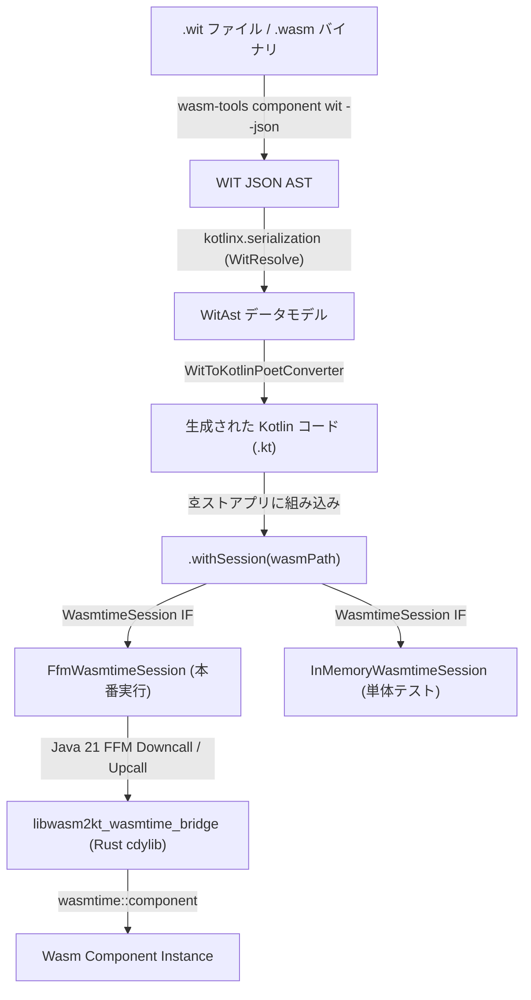

# アーキテクチャ解説 (`wasm2kt`)

このドキュメントでは、`wasm2kt` のコード生成パイプラインと、JVM Foreign Function & Memory (FFM) API + Rust `wasmtime` による実行時アーキテクチャを解説します。

---

## 1. 全体パイプライン

`wasm2kt` は大きく **「コンパイル時のコード生成層」** と **「実行時の Wasmtime ブリッジ層」** の2つで構成されています。

---

## 2. コード生成層 (`wasm2kt.ast` / `wasm2kt.generator`)

### 2.1 `wasm-tools` JSON AST のデコード ([WitAst.kt](../ast/src/main/kotlin/wasm2kt/ast/WitAst.kt))
* Bytecode Alliance 公式の `wasm-tools component wit --json` をフロントエンドとして使用することで、WIT のパッケージ解決・`use` インポート・`.wasm` バイナリからの埋め込み WIT 抽出を 100% 上流仕様と互換性のある形で処理します。
* JSON 内のポリモーフィックな型参照（プリミティブ文字列 `"s32"` と型テーブルインデックス整数 `7` の混在など）は、`WitTypeRefSerializer`, `WitTypeDefKindSerializer`, `WitFunctionKindSerializer`, `WitWorldItemSerializer` のカスタムシリアライザで型安全にデコードされます。

### 2.2 KotlinPoet によるコード生成 ([WitToKotlinPoetConverter.kt](../generator/src/main/kotlin/wasm2kt/generator/WitToKotlinPoetConverter.kt))
* KotlinPoet 2.2 の `contextParameter("session", sessionClassName)` API を使用して Kotlin 2.2+ の Context Parameters 構文を出力します。
* 生成時に KotlinPoet がデフォルトで付与する冗長な `public` 修飾子は、`formatIdiomaticKotlin` によって除去され、Kotlin のコーディング規約に沿ったクリーンなコードが出力されます。

---

## 3. ランタイム実行層 (`wasm2kt.runtime` & `rust-bridge`)

### 3.1 `WasmtimeSession` による抽象化
生成された World の関数や Resource はすべて `WasmtimeSession` インターフェースを経由してランタイムと通信します。

* **`FfmWasmtimeSession`（デフォルト）**: Java 21 FFM API を使って Rust の `wasmtime` 共有ライブラリを呼び出す本番実装。
* **`InMemoryWasmtimeSession`**: 純粋な Kotlin の Map とラムダで関数・リソーステーブルをシミュレートするモック実装。

### 3.2 JVM FFM API ブリッジ ([FfmWasmtimeBridge.kt](../runtime-wasmtime/src/main/kotlin/wasm2kt/runtime/FfmWasmtimeBridge.kt))
JNI（Java Native Interface）のボイラープレートや C ヘッダ生成を避け、JDK 21 の `java.lang.foreign` (`Linker`, `SymbolLookup`, `Arena`, `MemorySegment`, `FunctionDescriptor`) を使用しています。

* **Downcall（Kotlin → Rust Wasmtime）**:
  * `wasm2kt_session_open`: コンポーネントのロードとインスタンス化
  * `wasm2kt_session_invoke`: エクスポート関数・リソースコンストラクタ・メソッドの呼び出し
  * `wasm2kt_session_drop_resource`: リソースハンドルの破棄
  * `wasm2kt_session_close`: `Store` の解放
* **Upcall Stub（Rust Wasmtime → Kotlin Host Imports）**:
  * `Linker.nativeLinker().upcallStub(...)` により、Kotlin の `HostCallbackDispatcher.onHostCall` メソッドを C 関数ポインタ（`extern "C" fn`）として Rust 側の `wasmtime::component::Linker` に渡します。
  * これにより、Wasm コンポーネント内部からホストの import が呼ばれた際、`Linker` に登録された Kotlin 側の実装（import した interface ごとの Kotlin interface。ADR-0011）がシームレスにコールバックされます。

### 3.3 Rust Wasmtime ブリッジ ([rust-bridge/src/lib.rs](../rust-bridge/src/lib.rs))
* Wasmtime の公式 C API (`libwasmtime`) は現時点で Core Wasm が中心であり Component Model の高レベル型 (`wasmtime::component::Val` や `ResourceAny`) の操作が難しいため、Rust の `wasmtime` クレート（`48.0.8` LTS、`component-model` feature 有効。版の方針は [ADR-0010](adr/0010-wasmtime-lts.md)）を直接ラップした薄い `cdylib` を採用しています。
* **名前解決の柔軟性**:
  * `.wit` から生成したバインディングと `.wasm` から生成したバインディングの両方で動くよう、`resolve_exported_func` はトップレベルエクスポートだけでなく、エクスポートされたインターフェース（例: `example:counter/counter-api@0.1.0`）内部の関数やリソースメソッド（`[constructor]counter`, `[method]counter.increment`, `[static]counter.merge`）も自動探索して解決します。
* **リソーステーブル管理**:
  * `StoreData` 内の `HashMap<i32, ResourceAny>` で Wasmtime の `ResourceAny` を整数ハンドルにマッピングし、`Type::Borrow` の場合は参照維持、`Type::Own` の場合はマップから `remove` して所有権をゲストへ移動、`dropResource` 呼び出し時は `resource_drop(&mut store)` を実行します。
