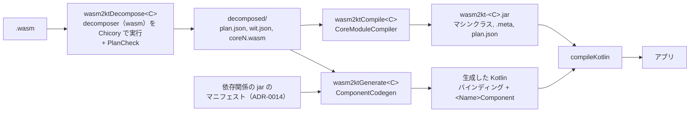
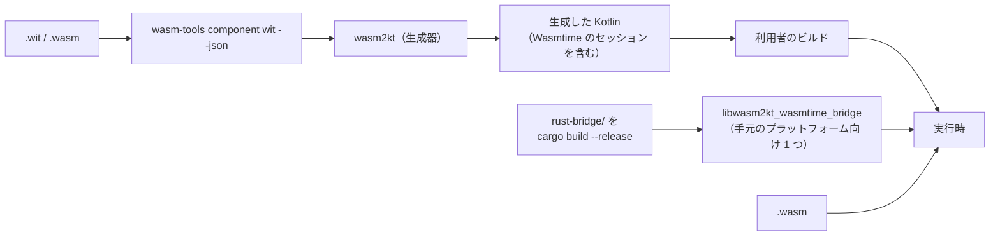
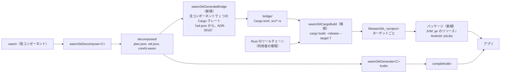

# ビルドの順序

> 2026-11-03 時点の `main` と、[ADR-0015](adr/0015-binary-value-boundary.md)（提案）で加わる型付きブリッジのビルドを説明します。
> ADR-0015 の未決の点のうち、ビルドに関わるもの（WIT の取り出し、型付きブリッジのビルドとキャッシュ、CLI）を判断するための資料です。
> いずれも 2026-11-04 に決まりました（4 節、5 節、6 節）。
>
> **2026-11-04 追記**: 型付きブリッジは、`bindgen!` ではなく、tooling が wit.json から Rust の型と呼び出しを生成する方式にしました（[ADR-0016](adr/0016-typed-bridge-from-wit-json.md)）。
> WIT を取り出す段階（4 節）は要らなくなりました。CLI（6 節）は実装済みです。Gradle プラグインでの Wasmtime の対応（3.2 節、5 節）は、今は行わないことにしました（2026-11-04）。ライブラリは jar のリソースから読み込む方針です（#65）。

## 1. 成果物と、それを使う時期

| 成果物 | 作るもの | 使う時期 | 使うもの |
| :--- | :--- | :--- | :--- |
| `wit.json`（WIT の AST） | decomposer / `wasm-tools component wit --json` | ビルド時 | Kotlin の生成器 |
| `plan.json`、`coreN.wasm` | decomposer | ビルド時（AOT コンパイル）と実行時 | `CoreModuleCompiler`、Chicory |
| マシンクラス、`.meta` | `CoreModuleCompiler`（Chicory の build-time compiler） | 実行時 | Chicory |
| 生成した Kotlin | 生成器 | ビルド時（コンパイル） | Kotlin コンパイラー |
| `.wasm`（コンポーネント） | 利用者 | 実行時 | Wasmtime（汎用ブリッジ） |
| rust-bridge（cdylib） | 利用者の `cargo build` | 実行時 | Wasmtime バックエンド |
| 型付きブリッジのクレート（新規） | tooling の `TypedBridge`（`wit.json` から。ADR-0016） | ビルド時 | `cargo build` |
| 型付きブリッジ（cdylib、新規） | 生成した Cargo クレートの `cargo build` | 実行時 | Wasmtime バックエンド |

型付きブリッジは、Kotlin の生成と同じ `wit.json` から作ります。実行時に Wasmtime が読むのは、今と同じ `.wasm`（または `.cwasm`）です。

## 2. 今のビルド

### 2.1 Gradle プラグイン（Chicory）



* 3 つのタスクは、コンポーネントごとに登録します（`<C>` はコンポーネント名）
  * `Wasm2KtDecomposeTask`
  * `Wasm2KtCompileTask`
  * `Wasm2KtGenerateTask`
* tooling は、`wasm2ktTooling` 構成で解決した class path を使い、分離した class loader の worker で動きます（ADR-0004）
* 生成した Kotlin の置き場所
  * Kotlin/JVM: `main` のソースに加えます
  * Android: variant ごとに生成タスクを登録し、`variant.sources.java` に加えます（`wasm2ktGenerate<C><Variant>`）
* AOT コンパイル結果の jar は、`implementation` のファイル依存として加えます（Android では dex に入ります）
* すべてのタスクは `@CacheableTask` で、入力は `.wasm`、パッケージ名、world 名、対応表などです
* Rust のツールチェーンも `wasm-tools` も使いません（decomposer は wasm として tooling に同梱しています）

### 2.2 CLI（Wasmtime）



* rust-bridge は、生成とは独立して、利用者が 1 回だけ `cargo build` します
  * すべてのコンポーネントで共有します
  * ターゲットの指定はありません（#59）
* 実行時の読み込み
  * ブリッジは `-Dwasm2kt.bridge.lib`、`WASM2KT_BRIDGE_LIB`、`rust-bridge/target/release/` の順に探します
  * `.wasm` は、`openSession(path)` などで実行時に渡します
* `integration-tests` も同じ前提です。テストの前に `cargo build --release --manifest-path rust-bridge/Cargo.toml` が要ります

## 3. ADR-0015 のあとのビルド

### 3.1 汎用ブリッジ

ビルドの順序は 2.2 と変わりません。rust-bridge の中身（JSON → バイナリ形式）が変わるだけです。

### 3.2 型付きブリッジ（Gradle プラグインのオプション）



**順序の制約**

* `wasm2ktGenerateBridge` は、すべてのコンポーネントの分解が終わってから動きます。1 つのクレートに全部のコンポーネントを入れるためです（ADR-0015: wasmtime をプロセスに 1 つだけ読み込む）
* Kotlin の生成と Rust の生成は、互いに依存しません
  * 両者を結びつけるのは、コンポーネントの ID と関数のインデックスだけです
  * ID はコンポーネント名、インデックスは WIT の宣言順にすれば、どちらも決定的に決まり、片方の出力をもう片方が読む必要はありません
* `compileKotlin` は型付きブリッジのビルドを待ちません。ネイティブライブラリは実行時にだけ要るので、パッケージのタスクにだけつなぎます

**新しく必要になるもの**

* 利用者の環境の `cargo` と、ターゲットごとの Rust の標準ライブラリ（`rustup target add`）
* ネイティブライブラリを jar のリソースから読み込む仕組み（今は、ファイルのパスから読み込むだけ）
* Android では、ABI ごとのビルドと `jniLibs` への配置（#60 の判断による）

## 4. A: WIT をどこで取り出すか

**決定（2026-11-04）:** A1。decomposer が `wit-component` で出力する。

**見直し（2026-11-04、[ADR-0016](adr/0016-typed-bridge-from-wit-json.md)）:** `bindgen!` を使わないことにしたので、WIT を取り出す段階は要らなくなりました。
型付きブリッジの Rust の型は、tooling が wit.json から生成します。以下は判断の記録として残します。

`bindgen!` は、WIT をビルド時に読みます（`path` の指定を wit-parser の `Resolve::push_path` に渡す）。

**確かめたこと**（2026-11-03、wasmtime =48.0.8、wasm-tools 1.258.0、`fixtures/same-name.wasm`）

| `bindgen!({ path: ... })` に渡したもの | 結果 |
| :--- | :--- |
| コンポーネントの `.wasm` そのもの | エラー: `found an actual component instead of an encoded WIT package in wasm` |
| WIT パッケージを wasm にエンコードしたもの（`wasm-tools component wit --wasm`） | 成功 |
| WIT のテキスト（`wasm-tools component wit`） | 成功 |

コンポーネントをそのまま渡すことはできないので、ビルドのどこかで、コンポーネントから WIT を取り出す段階が要ります。候補は次のとおりです。

| 案 | 内容 | 長所 | 短所 |
| :--- | :--- | :--- | :--- |
| A1 | decomposer が、WIT パッケージを wasm にエンコードしたもの（`world.wasm`）か、WIT のテキスト（`world.wit`）を出力する（`wit-component`） | `wasm-tools` と同じ実装なので正確。今の decomposer の 1 回の実行で済む | decomposer の wasm が大きくなる。出力を変えると `build-wasm.sh` と `regenerate-fixtures.sh` が要る |
| A2 | Kotlin の生成器が `wit.json` から WIT のテキストを書く | decomposer を変えずに済む | WIT の printer を自作して保守する。`use`、resource、ネストした package などで、元の WIT とずれる危険がある |
| A3 | ビルド時に `wasm-tools component wit` を実行する | 実装が要らない | Gradle プラグインの利用者に `wasm-tools` が要るようになる（今は不要） |

A1 がよいと考えます。テキストと wasm のどちらでも `bindgen!` は読めますが、wasm にエンコードした WIT パッケージなら、
printer の書式の違いを気にせずに済みます。どちらを出すかは、デバッグのしやすさ（テキストは人が読める）で決めればよく、両方出してもかまいません。

world の名前: コンポーネントから取り出した WIT は `package root:component; world root { ... }` になります（Kotlin の生成で `RootWorld` になるのと同じ）。
`bindgen!` には `world: "root"` を渡します。

## 5. B: 型付きブリッジのタスクと、キャッシュのキー

**決定（2026-11-04）:** 型付きブリッジを有効にしたビルドでは、`cargo` を前提にする。見つからなければビルドを失敗させる（汎用ブリッジには落とさない）。
ビルドが遅いことは受け入れ、改善は後で行う。

**タスクの分け方**

* `wasm2ktGenerateBridge`（Rust の生成）と `wasm2ktCargoBuild`（`cargo` の実行）を分けます
  * 生成は速く、決定的で、キャッシュしやすいです
  * `cargo` は遅く、外部のツールチェーンに依存します
* `wasm2ktCargoBuild` は、ターゲットごとに 1 つのタスクにします（#59）

**キャッシュのキー（`wasm2ktCargoBuild` の入力）**

キャッシュするのは、`wasm2ktCargoBuild` の出力（ビルド済みの cdylib）です。Gradle は入力のハッシュをキーにして、入力が変わらなければ `cargo build` を実行せず（UP-TO-DATE）、
ビルドキャッシュにあれば取り出します（FROM-CACHE）。

**決定（2026-11-04）:**

| 入力 | キーに含めるか | 理由 |
| :--- | :--- | :--- |
| 生成したクレートの内容（Cargo.toml、`src/`、Cargo.lock） | 含める | コンポーネントの WIT が変われば変わる。wasmtime の版と features（プラグインが固定する。ADR-0010）もここに含まれる |
| ターゲットのトリプル | 含める | ターゲットごとに別の成果物 |
| コンポーネントの `.wasm` そのもの | 含めない | ブリッジが依存するのは WIT だけ。実装（core の wasm）が変わっても、WIT が同じなら作り直さない。実行時に読むのは `.wasm` そのもの |
| `rustc -vV` の出力 | 含めない | ツールチェーンを上げる理由はさまざまで、ブリッジを作り直す必要があるとは限らない。作り直すかは開発者が判断する（タスクを再実行するか、出力を消す） |
| ビルドのプロファイル | 含めない | 常に release でビルドする |

ツールチェーンの版をキーに含めないので、ビルドキャッシュを複数のマシンで共有すると、別の版の `rustc` で作ったライブラリが使われることがあります。
ブリッジと Kotlin の間は C ABI なので、`rustc` の版が違っても動作には影響しません。

**Gradle のキャッシュと、Cargo の target ディレクトリ**

* Gradle のビルドキャッシュには、成果物（cdylib）だけを入れます
* Cargo の target ディレクトリは、Gradle の出力にはせず、プロジェクトの外で共有します（例: Gradle のユーザーディレクトリの下）
  * wasmtime のコンパイル（初回は分単位）を、プロジェクトやコンポーネントの変更をまたいで使い回すためです
  * ディレクトリの中身は Gradle のキャッシュのキーに含めません
* Cargo.lock はプラグインが持ち、生成したクレートに置きます。依存の版を固定し、キャッシュのキーを安定させるためです

**改善の候補（後で）**

* Cargo の target ディレクトリの共有（上記）で、2 回目以降は wasmtime のコンパイルを省く
* wasmtime の features を必要なものに絞る
* 開発中は汎用ブリッジで動かし、型付きブリッジはアプリの release のビルドのときだけ作る（cargo のプロファイルは常に release）

## 6. D: CLI から型付きブリッジを作る

**実装（2026-11-04）:** 次の形で入りました。

```text
wasm2kt generate <入力> -o <出力> -p <パッケージ> --bridge-id calc     # 型付きブリッジの calc として開く
wasm2kt bridge -o <クレート> --component calc=calc.wasm --component http=http.wasm \
    [--world calc=<world>] [--build] [--target <トリプル>] [--target-dir <dir>]
```

* `--component` の入力は、`.wasm`、`.wit`、WIT の JSON です（`.json` 以外は `wasm-tools component wit --json` で読みます）
* `--build` は、ビルドしたライブラリのパスを出力します。ライブラリは汎用ブリッジと同じ名前（`libwasm2kt_wasmtime_bridge`）なので、`-Dwasm2kt.bridge.lib` で指定するか、汎用ブリッジの代わりに置きます
* サブコマンドのない `wasm2kt <入力> -o ... -p ...` は、`generate` と同じに扱います

以下は判断のときの記録です。

今の CLI（`wasm2kt`）は、ビルドの 1 段階として呼ぶコード生成器です。`.wit` / `.wasm` から Kotlin のバインディングを生成するだけで、ビルドそのものは実行しません。
分解、AOT コンパイル、`<Name>Component` の生成（Chicory 向け）は tooling（`ComponentBuild`）にあり、使っているのは Gradle プラグインだけです。

**決定（2026-11-04）:** 生成とは別のサブコマンドにする。段階ごとにコマンドが分かれるので、タスクランナー（make、just など）と組み合わせやすい。

Gradle を使わない利用者も、型付きブリッジを作れるようにします。

```text
wasm2kt generate ...                      # 今の生成（今のオプションのまま）
wasm2kt bridge -o <クレートの出力先> \
    --component calc=calc.wasm --component http=http.wasm \
    [--build] [--target <トリプル>]       # --build で cargo build も実行する
```

* サブコマンドに分ける理由は 2 つ
  * 今の生成は、1 回の呼び出しで world を 1 つ扱う（ADR-0012）。型付きブリッジは、プロジェクトの全コンポーネントで 1 つのライブラリにする（wasmtime をプロセスに 1 つだけ読み込むため）。生成のオプションにすると、コンポーネントごとにライブラリができてしまう
  * 生成は `cargo` なしで動く。ブリッジには `cargo` が要る
* `bridge` は、Gradle プラグインと同じ tooling の処理（WIT の取り出し、クレートの生成、`cargo` の実行）を呼ぶ
* `--build` を付けないときは、クレートを生成するだけにする。利用者が自分のビルド（`cargo` のワークスペースなど）に組み込めるようにするため
* 今の `wasm2kt <入力> -o ... -p ...` の形は、`generate` の別名として残す
* コンポーネント名は、Kotlin の生成（`generate`）で使う ID と一致させる必要がある（3.2 節）

Chicory 向けのビルド（分解と AOT コンパイル）を CLI に出すかは、別の論点として扱います。
