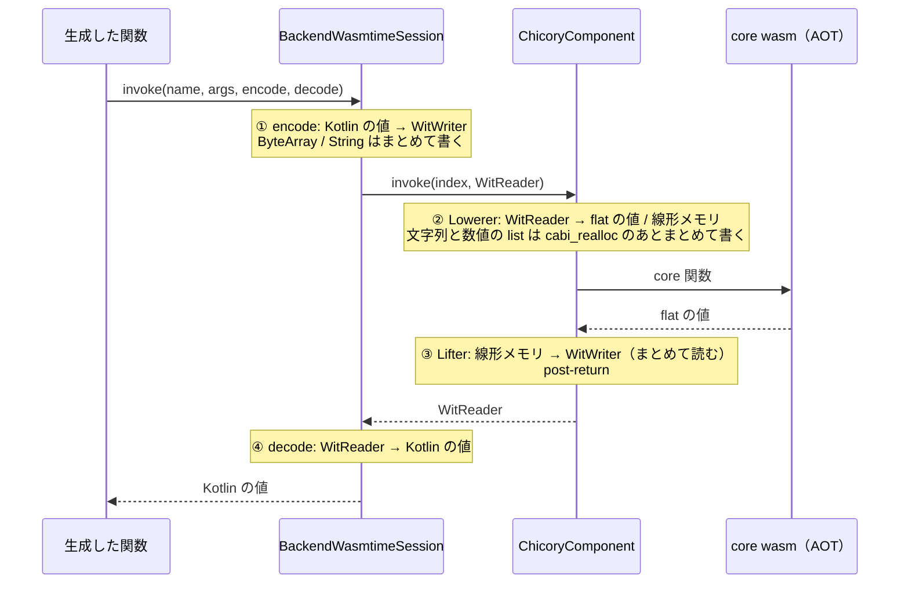
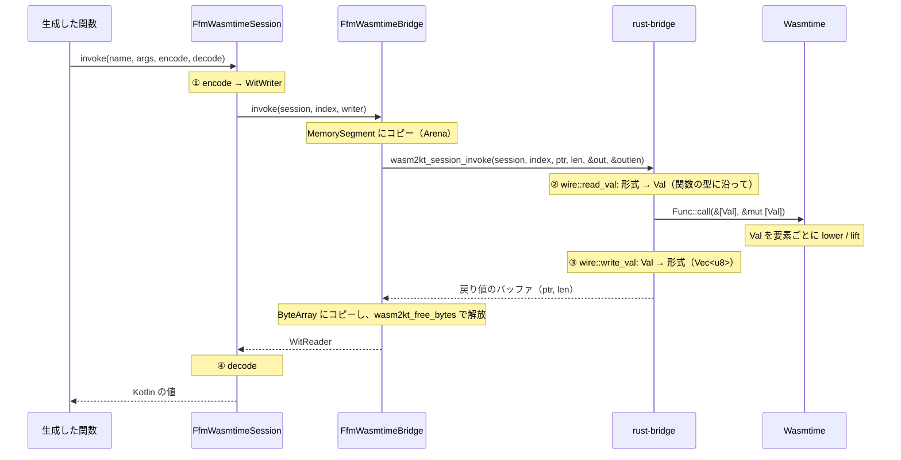
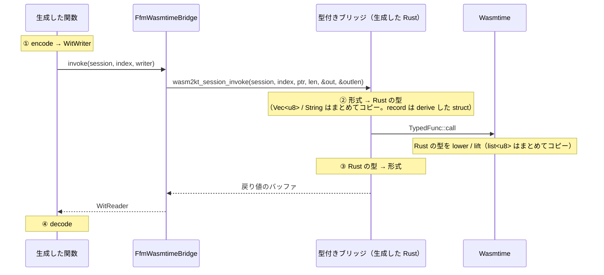

# Kotlin から wasm の関数を呼び出す経路

> [ADR-0015](adr/0015-binary-value-boundary.md) の進め方の 1（JSON 境界をバイナリ形式に置き換える）と 2（Wasmtime の型付きブリッジ、[ADR-0016](adr/0016-typed-bridge-from-wit-json.md)）のあとの経路を説明します（2026-11-04）。
> 時間の数値は [docs/performance.md](performance.md) のものです。

## 1. 登場するもの

| 層 | 実体 | 役割 |
| :--- | :--- | :--- |
| 生成した関数 | `context(session: Session) fun scale(...)` など | Kotlin の値を受け取り、`session.runtimeSession.invoke(名前, 引数, エンコーダー, デコーダー)` を呼ぶ |
| `HostResourceBoundSession` | 生成コード（`WitSupport.kt`） | 呼び出しの間、セッションの `HostResourceTable` をスレッドに束縛する（ADR-0008） |
| `BackendWasmtimeSession` | 生成コード | `ComponentBackend`（Chicory）への橋渡し。関数名をインデックスにして覚え、引数を `WitWriter` に書く |
| `FfmWasmtimeSession` / `JniWasmtimeSession` | 生成コード | Wasmtime ブリッジへの橋渡し。同上 |
| `WitWriter` / `WitReader` | `runtime-api` | 値のバイナリ形式（ADR-0015）の読み書き |
| `ChicoryComponent` | `runtime-chicory` | 関数名の解決、Canonical ABI の lower / lift、core 関数の呼び出し |
| `FfmWasmtimeBridge` / `JniWasmtimeBridge` | `runtime-wasmtime` | ネイティブ関数の呼び出し（ダウンコール）と、ホスト import のコールバック（アップコール） |
| rust-bridge | `rust-bridge/core`（共通部）、`rust-bridge/src`（汎用ブリッジ） | セッション、C ABI / JNI。汎用の経路は、バイナリ形式と `Val` の変換と `Func::call` |
| 型付きブリッジ | tooling が生成するクレート（`TypedBridge`、ADR-0016） | コンポーネントごとの Rust の型と、`Func::typed` / `func_wrap` による型付きの呼び出し |
| `Linker` | `runtime-api` | ホスト import のキーから、生成した `HostFunction` を引く（ADR-0011） |

## 2. 共通: 名前の解決

* 関数名は、セッションで最初に呼ぶときに 1 回だけ解決してインデックスにする（`resolve(name): Int`）。生成したセッションがインデックスを覚える。名前の解決規則は ADR-0011 のまま
* ホスト import は、バックエンドが import ごとにインデックスを振り、最初のコールバックで `hostFunction(key)` を引いて覚える
* 形式にはタグがない。両側が関数の型を知っているので、値だけを宣言の順に書く（`WitWire.kt` の KDoc を参照）

## 3. 経路

### 3.1 エクスポートの呼び出し: Chicory

変換は 4 回です。ただ、要素ごとのオブジェクトはなく、バイト列と文字列はまとめてコピーされます。

### 3.2 エクスポートの呼び出し: Wasmtime（汎用ブリッジ）

* JSON の文字列化と解析はなくなった
* `Val` の要素ごとの変換は、Rust の中に残る（`list<u8>` も `Val::U8` の `Vec`）。これを除くのが型付きブリッジ（3.3）
* JNI では、`MemorySegment` の代わりに `byte[]` で受け渡す
* バッファは呼び出しごとに確保する（4 節の C1）

### 3.3 エクスポートの呼び出し: Wasmtime（型付きブリッジ）

セッションをコンポーネントの ID 付きで開いたとき（`wasm2kt generate --bridge-id`）の経路です。

* `Val` を通らない。`list<u8>` と文字列は、どの段階でもまとめてコピーされる
* 関数名の解決（2 節）は汎用の経路と同じ処理で、見つけた関数の正規の名前で、型付きの呼び出しを引く
* 型付きの呼び出しを生成できなかった関数は、汎用の経路（3.2 節）で呼ぶ
* Kotlin 側の形式と生成コードは変わらない。違うのは、セッションを開くときに ID を渡すことだけ

### 3.4 ホスト import

Chicory も Wasmtime も、同じ順序です。

1. バックエンドが、引数を形式に書く（Chicory は Lifter、Wasmtime は `wire::write_val`、型付きブリッジは `func_wrap` に登録した生成コード）
2. import のインデックスでコールバックする（Wasmtime はアップコール `cb(index, key, args, len, &out, &outlen)`）
3. 生成した `HostFunction` が `WitReader` から静的にデコードし、実装を呼び、戻り値を `WitWriter` に書く
4. バックエンドが、戻り値を lower する（Wasmtime は Kotlin が `wasm2kt_alloc_bytes` の領域にコピーし、Rust が `wire::read_val` で読む）

## 4. バッファを呼び出しごとに確保するか、使い回すか（ADR-0015 の未決 C）

バッファは 4 か所にあります。

| バッファ | 書く側 | 読む側 |
| :--- | :--- | :--- |
| エクスポートの引数 | Kotlin（生成コード） | バックエンド |
| エクスポートの戻り値 | バックエンド | Kotlin |
| ホスト import の引数 | バックエンド | Kotlin |
| ホスト import の戻り値 | Kotlin | バックエンド |

### 4.1 使い回しが安全かどうか

使い回せるかどうかは、同じバッファを同時に 2 つの用途で使うことがあるかで決まります。

* **同じセッションへの同時の呼び出し:** 起きない。生成したセッションの呼び出しは `@Synchronized` で、`ComponentBackend` もセッションごとに直列に使う前提になっている
* **同じセッションへの再入:** 起きない。ホスト import の中から同じインスタンスを呼ぶことは、仕様（`may_enter`）で禁じられていて、両バックエンドともトラップにする
* **エクスポートの呼び出しの途中のホスト import:** 起きる。そのため、エクスポート用とホスト import 用のバッファは分ける必要がある
* **ホスト import の中から、別のセッションを呼ぶ:** 起きうる。ただし別のセッションのバッファを使うので、衝突しない
* **async（Chicory のみ、#16）:** 1 つのインスタンスで複数のタスクが並ぶ。タスクごとにバッファが要るので、#16 で見直す

同期の呼び出しに限れば、「セッションごとに、エクスポート用とホスト import 用を 1 組ずつ」持てば衝突しません。

### 4.2 選択肢

| 案 | 内容 | 長所 | 短所 |
| :--- | :--- | :--- | :--- |
| C1 | 呼び出しごとに確保する。Wasmtime の戻り値は、Rust が確保した `Vec` を Kotlin が読み、解放の関数を呼ぶ | 単純。今の文字列と同じ扱い。async でもそのまま使える | 呼び出しごとにネイティブのメモリの確保と解放（解放のダウンコールが 1 回増える）と、JVM の `ByteArray` の確保がある |
| C2 | セッションごとに使い回す。Rust のセッションが `Vec<u8>` を持ち、`clear()` して書き直す。ポインタは、そのセッションの次の呼び出しまで有効。Kotlin の `WitWriter` もセッションごとに 1 つ | 確保と解放がなくなる。解放のダウンコールも要らない | 「次の呼び出しまで有効」という約束を、Kotlin 側が守る必要がある（デコードし終わってから次を呼ぶ。生成コードなら守れる）。async では見直しが要る |

ホスト import の応答（Kotlin → Rust）の受け渡しには、別の判断があります。

* 今は、Rust が確保した領域（`wasm2kt_alloc_bytes`）に Kotlin がコピーしている
* C2 にするなら、コールバックの中から呼ぶ `wasm2kt_reserve_response(session, len) -> ptr` を用意し、セッションのバッファの領域を受け取って Kotlin が直接書く形にできる
* コールバックをやり直す方式（バッファが足りなければ必要な大きさを返して、もう一度呼ぶ）は使えない。ホストの実装に副作用があるため

### 4.3 判断の材料

* 確保のコストが効くのは、小さな値の呼び出しです。今の整数だけの呼び出しは、生成 DSL で JVM 0.3 µs、ART 3.3 µs です（Chicory）
* ADR-0015 の進め方の 3 では、数値だけの関数はバッファを通さず、C の引数で直接渡すことも検討しています。それを入れれば、小さな呼び出しでのバッファの確保の影響は小さくなります
* 大きな値では、確保よりコピーのほうが大きいので、C1 と C2 の差は小さいはずです

**決定（2026-11-04）:** まず C1 で実装し、`Bench` で計ります。小さな呼び出しで確保が目立てば C2 にします。C1 から C2 への変更は、ブリッジとセッションの中だけで済み、生成コードと形式は変わりません。

### 4.4 Kotlin 側の読み出し（FFM）

戻り値のバッファの読み方も、合わせて決めます。

* `ByteArray` にコピーしてから `WitReader` で読む: `WitReader` を 1 種類にできる（Chicory と JNI と共通。JVM 11）。コピーが 1 回増える
* `MemorySegment` を直接読む `WitReader` を `runtime-wasmtime` に置く: コピーが 1 回減る。生成コードが 2 種類の reader を扱えるように、`WitReader` をインターフェースにする必要がある

64 KiB のコピーは数 µs なので、まずは `ByteArray` にコピーする形で十分と考えます。
