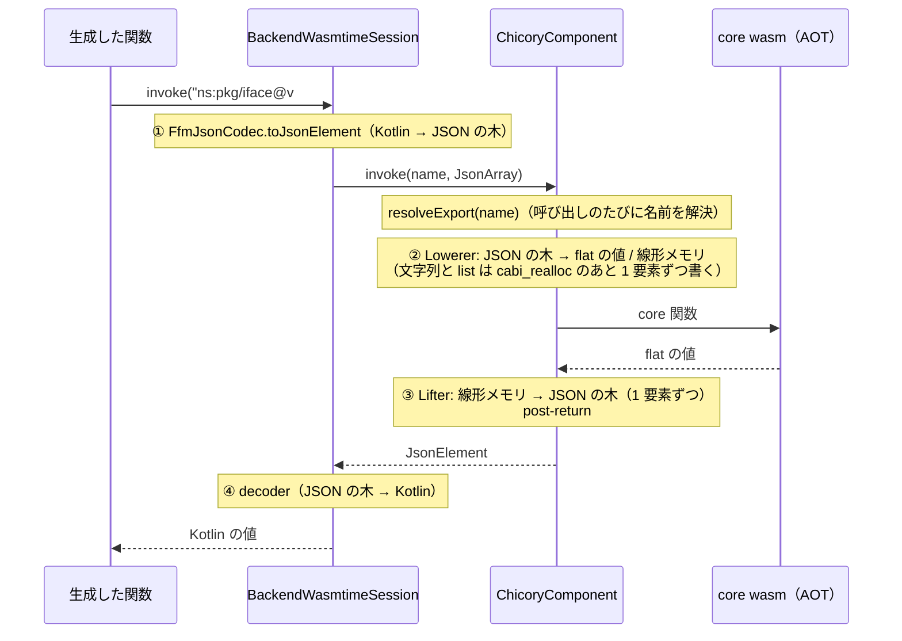
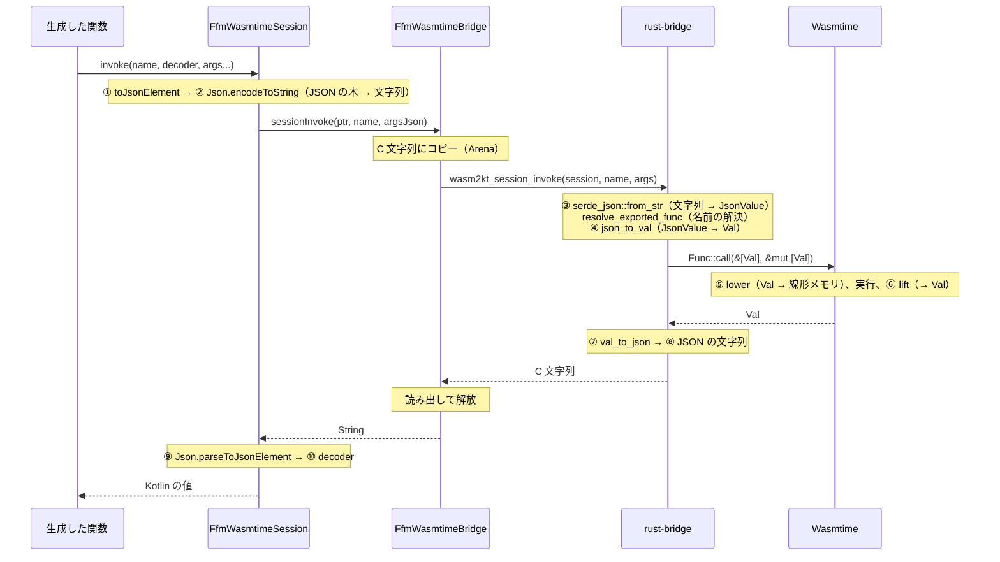
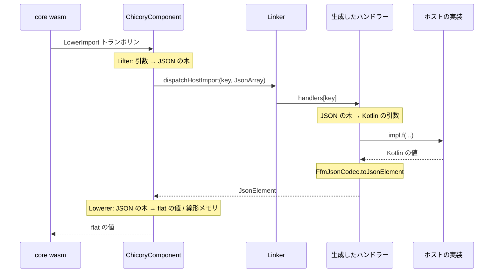
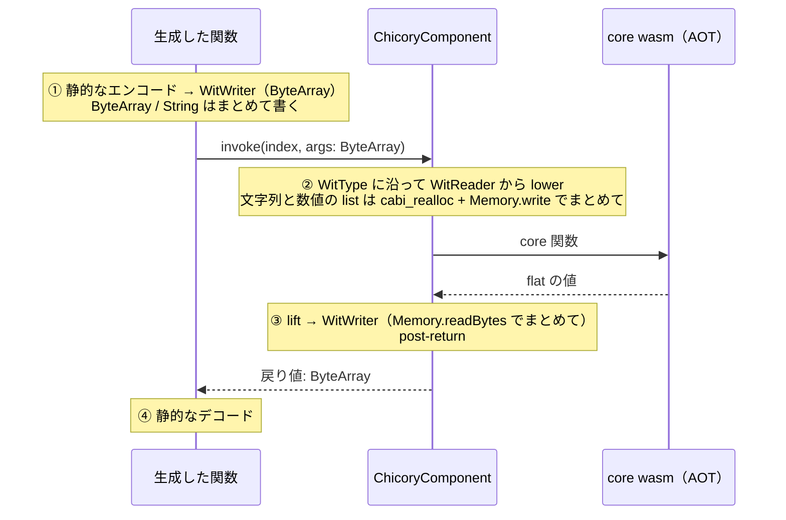
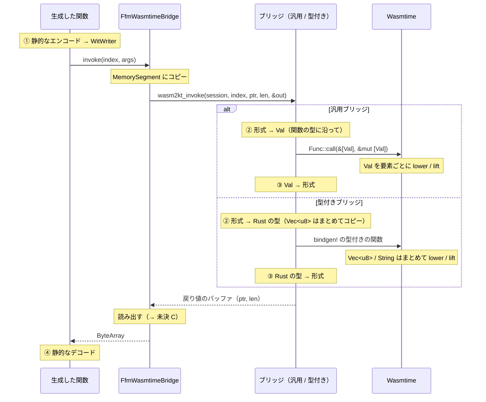

# Kotlin から wasm の関数を呼び出す経路

> 2026-11-03 時点の `main` と、[ADR-0015](adr/0015-binary-value-boundary.md)（提案）のあとの経路を説明します。
> ADR-0015 の未決の点のうち、呼び出しに関わるもの（戻り値のバッファを呼び出しごとに確保するか、使い回すか）を判断するための資料です。
> この点（C）は 2026-11-04 に決まりました（4 節）。
> 時間の数値は [docs/performance.md](performance.md)（#19）のものです。

## 1. 登場するもの

| 層 | 実体 | 役割 |
| :--- | :--- | :--- |
| 生成した関数 | `context(session: Session) fun scale(...)` など | Kotlin の値を受け取り、`session.runtimeSession.invoke(名前, デコーダー, 引数...)` を呼ぶ |
| `HostResourceBoundSession` | 生成コード（`WitSupport.kt`） | 呼び出しの間、セッションの `HostResourceTable` をスレッドに束縛する（ADR-0008） |
| `BackendWasmtimeSession` | 生成コード | `ComponentBackend`（Chicory）への橋渡し。引数を JSON にする |
| `FfmWasmtimeSession` / `JniWasmtimeSession` | 生成コード | Wasmtime ブリッジへの橋渡し。引数を JSON の文字列にする |
| `ChicoryComponent` | `runtime-chicory` | 関数名の解決、Canonical ABI の lower / lift、core 関数の呼び出し |
| `FfmWasmtimeBridge` / `JniWasmtimeBridge` | `runtime-wasmtime` | ネイティブ関数の呼び出し（ダウンコール）と、ホスト import のコールバック（アップコール） |
| rust-bridge | `rust-bridge/src/lib.rs` | JSON と `Val` の変換、Wasmtime の `Func::call` |
| `Linker` | `runtime-api` | ホスト import のキーから、生成したハンドラーを引く（ADR-0011） |

## 2. 今の経路

### 2.1 エクスポートの呼び出し: Chicory

要素ごとの変換が 4 回あります（① 〜 ④）。64 KiB の `list<u8>` で、① ④ が 2.8 ms、② ③ と実行が 4.7 ms（JVM）です。

### 2.2 エクスポートの呼び出し: Wasmtime（FFM）

要素ごとの変換が 10 回あります。64 KiB で 16.5 ms（JVM）です。

### 2.3 ホスト import: Chicory

### 2.4 ホスト import: Wasmtime（FFM）

rust-bridge は、`func_new` で登録したクロージャーから `invoke_host_callback` を呼びます。

1. `val_to_json` と `serde_json::to_string` で、引数を JSON の文字列にする
2. アップコール `cb(import_name, args, &out_ptr, &out_len)` で Kotlin を呼ぶ
3. Kotlin は文字列を解析し、`Linker` でハンドラーを呼び、応答の JSON の文字列を作る
4. Kotlin が、`wasm2kt_alloc_bytes` で Rust が確保した領域に応答をコピーして返す
5. Rust がそれを解析し、`json_to_val` で戻り値の `Val` にする

## 3. ADR-0015 のあとの経路

### 3.1 共通: セッションを開くとき

* 関数名を、セッションを開くときに 1 回だけ解決してインデックスにする（`resolve(name): Int`）。名前の解決規則は ADR-0011 のまま
* ホスト import のキーも、同じときにインデックスにする。コールバックはインデックスで呼ぶ
* 生成コードは、セッションごとにインデックスを持つ（関数ごとに最初の呼び出しで解決して覚える）

今は、両方のバックエンドが呼び出しのたびに文字列で関数を探しています（`resolveExport`、`resolve_exported_func`）。

### 3.2 エクスポートの呼び出し: Chicory

変換の回数は 4 回のままです。ただ、要素ごとのオブジェクトがなくなり、バイト列と文字列はまとめてコピーされます（データは 4 回コピーされる）。

### 3.3 エクスポートの呼び出し: Wasmtime

* JSON の文字列化と解析（今の ②③⑦⑧⑨）がなくなる
* 汎用ブリッジでは、`Val` の要素ごとの変換が Rust の中に残る。型付きブリッジでは、それもなくなる
* JNI では、`MemorySegment` の代わりに `byte[]` で受け渡す

### 3.4 ホスト import

Chicory も Wasmtime も、2.3 / 2.4 と同じ順序で、JSON の代わりに形式のバイト列を受け渡します。

1. バックエンドが、引数を形式に書く
2. import のインデックスでコールバックする
3. 生成したハンドラーが静的にデコードし、実装を呼び、戻り値を形式に書く
4. バックエンドが、戻り値を lower する

Wasmtime のアップコールでは、応答のバイト列を Rust に渡す方法が要ります（未決 C の後半）。

## 4. 未決 C: バッファを呼び出しごとに確保するか、使い回すか

バッファは 4 か所にあります。

| バッファ | 書く側 | 読む側 |
| :--- | :--- | :--- |
| エクスポートの引数 | Kotlin（生成コード） | バックエンド |
| エクスポートの戻り値 | バックエンド | Kotlin |
| ホスト import の引数 | バックエンド | Kotlin |
| ホスト import の戻り値 | Kotlin | バックエンド |

### 4.1 使い回しが安全かどうか

使い回せるかどうかは、同じバッファを同時に 2 つの用途で使うことがあるかで決まります。

* **同じセッションへの同時の呼び出し:** 起きない。生成したセッションの呼び出しは `@Synchronized` で、`ComponentBackend` もセッションごとに直列に使う前提になっている
* **同じセッションへの再入:** 起きない。ホスト import の中から同じインスタンスを呼ぶことは、仕様（`may_enter`）で禁じられていて、両バックエンドともトラップにする
* **エクスポートの呼び出しの途中のホスト import:** 起きる。そのため、エクスポート用とホスト import 用のバッファは分ける必要がある
* **ホスト import の中から、別のセッションを呼ぶ:** 起きうる。ただし別のセッションのバッファを使うので、衝突しない
* **async（Chicory のみ、#16）:** 1 つのインスタンスで複数のタスクが並ぶ。タスクごとにバッファが要るので、#16 で見直す

同期の呼び出しに限れば、「セッションごとに、エクスポート用とホスト import 用を 1 組ずつ」持てば衝突しません。

### 4.2 選択肢

| 案 | 内容 | 長所 | 短所 |
| :--- | :--- | :--- | :--- |
| C1 | 呼び出しごとに確保する。Wasmtime の戻り値は、Rust が確保した `Vec` を Kotlin が読み、解放の関数を呼ぶ | 単純。今の文字列と同じ扱い。async でもそのまま使える | 呼び出しごとにネイティブのメモリの確保と解放（解放のダウンコールが 1 回増える）と、JVM の `ByteArray` の確保がある |
| C2 | セッションごとに使い回す。Rust のセッションが `Vec<u8>` を持ち、`clear()` して書き直す。ポインタは、そのセッションの次の呼び出しまで有効。Kotlin の `WitWriter` もセッションごとに 1 つ | 確保と解放がなくなる。解放のダウンコールも要らない | 「次の呼び出しまで有効」という約束を、Kotlin 側が守る必要がある（デコードし終わってから次を呼ぶ。生成コードなら守れる）。async では見直しが要る |

ホスト import の応答（Kotlin → Rust）の受け渡しには、別の判断があります。

* 今は、Rust が確保した領域（`wasm2kt_alloc_bytes`）に Kotlin がコピーしている
* C2 にするなら、コールバックの中から呼ぶ `wasm2kt_reserve_response(session, len) -> ptr` を用意し、セッションのバッファの領域を受け取って Kotlin が直接書く形にできる
* コールバックをやり直す方式（バッファが足りなければ必要な大きさを返して、もう一度呼ぶ）は使えない。ホストの実装に副作用があるため

### 4.3 判断の材料

* 確保のコストが効くのは、小さな値の呼び出しです。今の整数だけの呼び出しは、生成 DSL で JVM 0.3 µs、ART 3.3 µs です（Chicory）
* ADR-0015 の進め方の 3 では、数値だけの関数はバッファを通さず、C の引数で直接渡すことも検討しています。それを入れれば、小さな呼び出しでのバッファの確保の影響は小さくなります
* 大きな値では、確保よりコピーのほうが大きいので、C1 と C2 の差は小さいはずです

**決定（2026-11-04）:** まず C1 で実装し、`Bench` で計ります。小さな呼び出しで確保が目立てば C2 にします。C1 から C2 への変更は、ブリッジとセッションの中だけで済み、生成コードと形式は変わりません。

### 4.4 Kotlin 側の読み出し（FFM）

戻り値のバッファの読み方も、合わせて決めます。

* `ByteArray` にコピーしてから `WitReader` で読む: `WitReader` を 1 種類にできる（Chicory と JNI と共通。JVM 11）。コピーが 1 回増える
* `MemorySegment` を直接読む `WitReader` を `runtime-wasmtime` に置く: コピーが 1 回減る。生成コードが 2 種類の reader を扱えるように、`WitReader` をインターフェースにする必要がある

64 KiB のコピーは数 µs なので、まずは `ByteArray` にコピーする形で十分と考えます。
