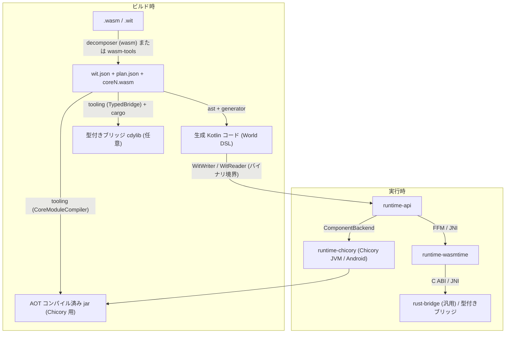

# アーキテクチャ

このドキュメントでは、`wasm2kt` のモジュール構成と、コード生成・Chicory バックエンド・Wasmtime ブリッジの全体構造を説明します。
ビルド順序の詳細は [ビルドの順序](build-pipeline.md)、関数呼び出し時の処理は [呼び出しの経路](call-path.md)、個別の設計判断は [ADR](../adr/README.md) を参照してください。

## 1. 全体像

`wasm2kt` は、**ビルド時のパイプライン**（WIT 解析・コンポーネント分解・AOT コンパイル・コード生成）と、**実行時のランタイム**（共通のバイナリ境界 + Chicory または Wasmtime）に分かれています。

## 2. モジュール構成

| モジュール | 役割 | JVM |
| :--- | :--- | :--- |
| `ast` | `wit.json`（`wasm-tools component wit --json` 形式）のデシリアライズモデル（`WitResolve`） | 21 |
| `generator` | KotlinPoet によるホストバインディング生成（`WitToKotlinPoetConverter`）と interface マニフェスト（`InterfaceManifest`） | 21 |
| `cli` | `wasm2kt` コマンド（`generate` と `bridge` サブコマンド） | 21 |
| `tooling` | コンポーネント分解（`Decomposer`）、AOT コンパイル（`CoreModuleCompiler`）、`<Name>Component` 生成（`ComponentCodegen`）、未対応機能検査（`PlanCheck`）、型付きブリッジ生成（`TypedBridge`） | 21 |
| `gradle-plugin` | `io.github.wasm2kt` プラグイン。Gradle Worker の独立クラスローダーで `tooling` を実行（[ADR-0004](../adr/0004-isolated-tooling-classloader.md)） | 21 |
| `runtime-api` | 生成コードと各バックエンドの契約（`ComponentBackend`、`Linker`、`HostResourceTable`、バイナリ形式の `WitWriter` / `WitReader`） | 17（Android API 26 互換） |
| `runtime-chicory` | `plan.json` を再生して Canonical ABI の lift / lower を行う純 JVM バックエンド（`ChicoryComponent`） | 17（Android API 26 互換） |
| `runtime-wasmtime` | Wasmtime ブリッジの Kotlin 側（`FfmWasmtimeBridge`、`JniWasmtimeBridge`、`BridgeLibrary`） | 21（`--enable-preview`） |
| `decomposer/` | `wasmtime-environ` を使って `.wasm` を core モジュールと `plan.json`・`wit.json` に分解する Rust ツール。`wasm32-wasip1` にビルドしたバイナリを `tooling` に同梱（[ADR-0002](../adr/0002-wasmtime-environ-decomposer.md)） | — |
| `rust-bridge/` | Wasmtime ブリッジの Rust ワークスペース。共通部 `core/`（`wasm2kt-bridge-core`）と汎用ブリッジの `cdylib` | — |
| `test-support` / `integration-tests` | テスト用の JSON ⇄ バイナリ変換（`JsonWire`）、両バックエンドの差分テスト、公式 Conformance テスト | 21 |

## 3. コード生成と値の境界

* **WIT JSON AST**: `wasm-tools component wit --json`（CLI の場合）または `decomposer`（Gradle プラグインの場合）が出力する JSON を `WitResolve` に読み込みます
* **パッケージと World の配置**: world の関数・`Session`・`withSession`・`imports(...)` は指定パッケージのトップレベルに生成し（[ADR-0012](../adr/0012-world-at-package-top-level.md)）、import / export した interface は `<base>.<ns>.<pkg>.<iface>` および `<base>.exports.<ns>.<pkg>.<iface>` に配置します（[ADR-0011](../adr/0011-qualified-interface-keys.md)）
* **型に沿ったバイナリ境界（[ADR-0015](../adr/0015-binary-value-boundary.md)）**: 生成コードとバックエンドの間では、リフレクションや JSON を使わず、各型に対して静的に生成された `WitWriter` / `WitReader` の読み書きコードでバイト列をやり取りします。これにより、生成コードは `runtime-api` のみに依存してコンパイルでき、`ByteArray` や `String` は要素ごとの変換なしにまとめてコピーされます

## 4. Chicory バックエンド (`decomposer` + `tooling` + `runtime-chicory`)

Android やネイティブライブラリを使わない環境向けのバックエンドです（[ADR-0001](../adr/0001-chicory-backend-for-android.md)）。

1. **分解 (`decomposer`)**: `wasmtime-environ`（Wasmtime 48 LTS）でコンポーネントを平坦化し、core モジュール群（`core0.wasm` …）、インスタンス化手順（`plan.json`）、WIT 定義（`wit.json`）を出力します。分解ツール自体を `wasm32-wasip1` にコンパイルして `tooling` に同梱し、ビルド時に Chicory 上で動かすため、利用者に Rust や `wasm-tools` は不要です
2. **AOT コンパイル (`CoreModuleCompiler` + `JvmMethodSplitter`)**: Chicory の build-time compiler とメソッド分割により、各 core モジュールを JVM バイトコードの `Machine` クラスと `.meta` に変換して jar にまとめます
3. **実行 (`ChicoryComponent`)**: `plan.json` に従って core インスタンス・メモリ・テーブル・トランポリン（ホスト import、resource 操作、multi-memory の文字列 / list transcoder など）を配線し、仕様の `trap_if` に沿って Canonical ABI の lift / lower を行います（[ADR-0007](../adr/0007-canonical-abi-validation.md)、[ADR-0013](../adr/0013-multi-memory-adapters.md)）

Chicory 本体は `InterpreterFallback.SILENT` 指定により、JVM の 64 KB 上限を超える Wasm 関数を AOT 生成の対象から外します。対象外の関数は Chicory のインタプリタで実行されます。

64 KB 未満で AOT 生成されたメソッドにも、実行環境ごとのコンパイル制限があります。HotSpot JVM の JIT コンパイラは既定で `-XX:+DontCompileHugeMethods` を有効にしています。そのため 8,000 バイトを超えるメソッドは JIT コンパイルされません。Android の ART も、`dex2oat` によるコンパイル時に DEX コード単位で 16,383 を超えるメソッドを除外します。除外されたメソッドはインタプリタへフォールバックします。

この制約を緩和するため、`CoreModuleCompiler` は [ADR-0021](../adr/0021-split-large-chicory-methods.md) に基づいて `JvmMethodSplitter` を呼び出します。`JvmMethodSplitter` は 7,500 JVM バイトを超える `func_<N>` 形式の生成メソッドを静的な補助メソッドへ分割します。一方で、Chicory が 64 KB 上限でインタプリタへ落とした関数は分割対象外です。Chicory の `com.dylibso.chicory.compiler.internal.CompilerUtil` が単一メソッドとして生成する `call_dispatch_0` ディスパッチャも分割対象外として残ります。`call_dispatch_0` が 8,000 バイトを超える場合は、デスクトップ JVM に `-XX:-DontCompileHugeMethods` を指定すると JIT コンパイルの対象に含められます。

分割後も上限を超える箇所は、Gradle タスクの `wasm2ktCompileWarnings<Cap>` が 3 種類の警告として出力します。対象となるのは、Chicory の 64 KB 上限によるインタプリタフォールバック関数数、ART の 16,383 DEX コード単位に相当する保守的閾値である 21,000 JVM バイト以上のメソッド数、HotSpot の 8,000 バイト上限を超えるメソッド数の 3 つです。

## 5. Wasmtime バックエンド (`runtime-wasmtime` + `rust-bridge`)

デスクトップ / サーバー JVM（JDK 21+）向けのネイティブ実行バックエンドです。

* **FFM と JNI**: `FfmWasmtimeBridge` は Java 21 の `java.lang.foreign`（Downcall / Upcall Stub）を使って C ABI 関数を呼び出します。`JniWasmtimeBridge` は同じ共有ライブラリの JNI エントリポイントを呼び出します
* **共通クレート (`rust-bridge/core`)**: セッション管理、リソーステーブル（`ResourceAny` とホスト側整数ハンドルの対応）、バイナリ形式（`wire`）、C ABI / JNI エクスポートマクロ（`export_bridge!`）を提供します
* **汎用ブリッジと型付きブリッジ（[ADR-0016](../adr/0016-typed-bridge-from-wit-json.md)）**:
  * **汎用ブリッジ (`rust-bridge/src`)**: どのコンポーネントに対しても動作し、バイナリ形式と `wasmtime::component::Val` を相互変換して `Func::call` を呼びます
  * **型付きブリッジ (`TypedBridge`)**: `wit.json` から Rust の構造体・enum（`ComponentType` / `Lift` / `Lower` を derive）を生成し、`TypedFunc::call` と `LinkerInstance::func_wrap` で `Val` を経由せずに呼び出します
