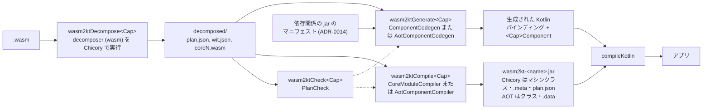
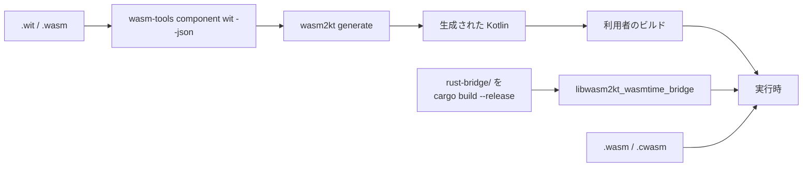
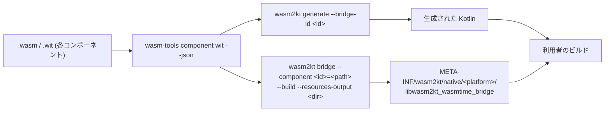

# ビルドの順序

このドキュメントでは、Gradle プラグインと CLI におけるビルド時の成果物と実行順序を説明します。

## 1. 成果物と使用時期

| 成果物 | 作成元 | 使用時期 | 使用先 |
| :--- | :--- | :--- | :--- |
| `wit.json`（WIT の AST） | `decomposer` / `wasm-tools component wit --json` | ビルド時 | Kotlin コード生成器、型付きブリッジ生成器 |
| `plan.json`、`coreN.wasm` | `decomposer` | ビルド時、`CHICORY` 実行時 | `AotComponentCompiler`、`CoreModuleCompiler`、`ChicoryComponent` |
| 静的 JVM クラス、`.data` | `AotComponentCompiler`（既定 `AOT`） | 実行時 | `runtime-aot`、生成 `<Name>Component` |
| マシンクラス（`.class`）、`.meta` | `CoreModuleCompiler`（`CHICORY` 用） | 実行時 | `ChicoryComponent` |
| 生成された Kotlin コード | `generator` / `ComponentCodegen` | ビルド時（コンパイル） | Kotlin コンパイラ |
| `rust-bridge`（汎用 `cdylib`） | `cargo build --manifest-path rust-bridge/Cargo.toml` | 実行時 | `runtime-wasmtime` |
| 型付きブリッジのクレートと `cdylib` | `wasm2kt bridge`（`TypedBridge` + `cargo build`） | 実行時 | `runtime-wasmtime` |

---

## 2. Gradle プラグイン

* `Wasm2KtDecomposeTask`、`Wasm2KtCheckTask`、`Wasm2KtCompileTask`、`Wasm2KtGenerateTask`、`Wasm2KtWarningsTask`
* Worker のクラスローダー分離
* ソースセットとバリアントへの登録
* ライブラリ jar としての依存追加
* 同梱 WebAssembly 版 decomposer の利用

コンポーネントごとに上記の Gradle タスクが登録されます。未対応機能や非同期拒否の検査は `Wasm2KtCheckTask` に分離されているため、バックエンドを切り替えても分解キャッシュは共有されます。また、`Wasm2KtWarningsTask` がキャッシュ復元時にも警告を再出力します。`tooling` は `wasm2ktTooling` 構成で解決したクラスパスを使い、分離したクラスローダーの Gradle Worker で動きます。詳細は [ADR-0004](../adr/0004-isolated-tooling-classloader.md) にまとめています。生成された Kotlin コードは Kotlin/JVM では `main` ソースセット、Android では各バリアントの `variant.sources.java` に登録されます。コンパイル結果の jar は `implementation` の依存として追加され、Android では通常のライブラリと同様に dex へ変換されます。なお、`decomposer` は WebAssembly として `tooling` に同梱されているため、利用側の環境に Rust ツールチェーンも `wasm-tools` も不要です。

---

## 3. CLI（Wasmtime 汎用ブリッジ）

* `rust-bridge` はコード生成とは独立して 1 回だけ `cargo build --release` します。ビルドされた共有ライブラリはすべてのコンポーネントで共有できます
* 実行時には、`BridgeLibrary` が共有ライブラリを読み込み、`openSession(wasmPath)` で渡された `.wasm`（または `openPrecompiledSession` の `.cwasm`）をインスタンス化します

---

## 4. CLI（Wasmtime 型付きブリッジ）

[ADR-0016](../adr/0016-typed-bridge-from-wit-json.md) に基づく型付きブリッジのビルド手順です。

* **1 プロセス 1 ブリッジ**: Wasmtime をプロセスに 1 つだけ読み込むため、プロジェクトで使うすべてのコンポーネントを 1 回の `wasm2kt bridge` に渡して 1 つのクレート・共有ライブラリにまとめます
* **Kotlin 生成と Rust 生成の独立性**: 両者を結びつけるのはコンポーネントの ID（`--bridge-id` と `--component <id>=...`）と関数名だけであり、出力を相互に読む必要はありません
* **クラスパスからの読み込み（[#65](https://github.com/chikoski/wasm-component-kotlin/issues/65)）**: `--resources-output` で出力したディレクトリを jar またはクラスパスに含めると、`BridgeLibrary` が実行プラットフォーム（`linux-x86_64`、`macos-aarch64`、`windows-x86_64` など）に対応するライブラリを一時ファイルへ展開して読み込みます
* **Cargo のキャッシュ**: `--target-dir` で共通のディレクトリを指定すると、2 回目以降のビルドで Wasmtime クレートの再コンパイルを省略できます
