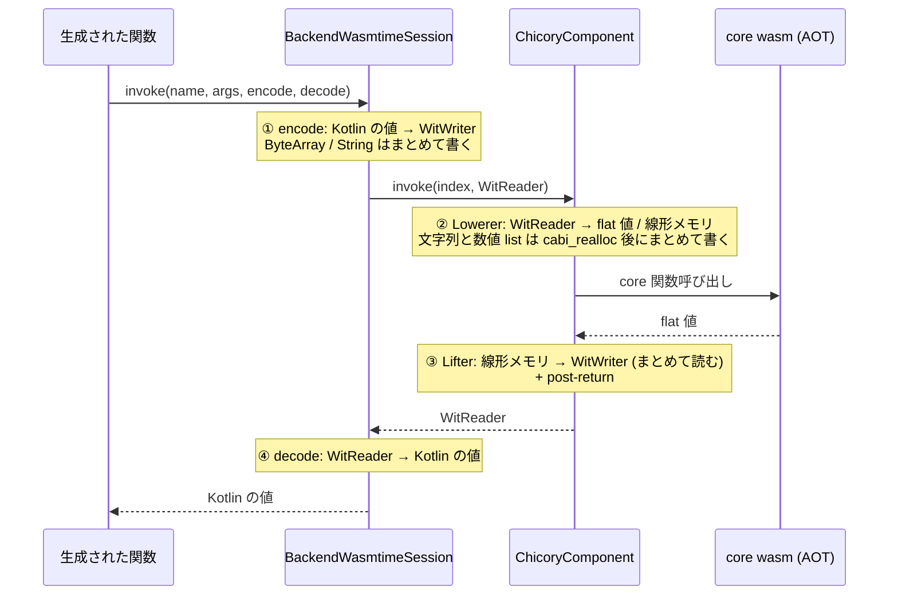
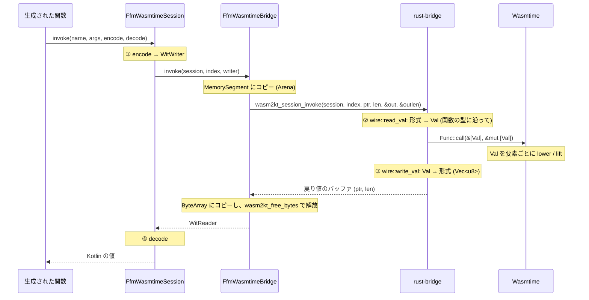
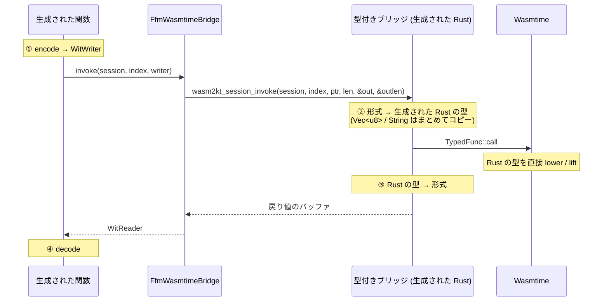

# Kotlin から wasm の関数を呼び出す経路

このドキュメントでは、生成された Kotlin 関数からバイナリ形式（[ADR-0015](../adr/0015-binary-value-boundary.md)）を経て Chicory または Wasmtime（汎用ブリッジ / 型付きブリッジ、[ADR-0016](../adr/0016-typed-bridge-from-wit-json.md)）で wasm の関数を実行するまでの経路を説明します。
各経路の実行時間は [性能とサイズ](performance.md) にあります。

## 1. 登場する層

| 層 | 実体 | 役割 |
| :--- | :--- | :--- |
| 生成された関数 | `context(session: Session) fun scale(...)` など | Kotlin の値を受け取り、`session.runtimeSession.invoke(名前, 引数, エンコーダー, デコーダー)` を呼ぶ |
| `HostResourceBoundSession` | 生成コード（`WitSupport.kt`） | 呼び出しの間、`@Synchronized` でセッションを直列化し、そのセッションの `HostResourceTable` をスレッドに束縛する（[ADR-0008](../adr/0008-host-defined-resources.md)、[#75](https://github.com/chikoski/wasm-component-kotlin/issues/75)） |
| `BackendWasmtimeSession` | 生成コード | `ComponentBackend`（Chicory）への橋渡し。関数名をインデックスにしてキャッシュし、引数を `WitWriter` に書く |
| `FfmWasmtimeSession` / `JniWasmtimeSession` | 生成コード | Wasmtime ブリッジへの橋渡し。同上 |
| `WitWriter` / `WitReader` | `runtime-api` | 値のバイナリ形式（[ADR-0015](../adr/0015-binary-value-boundary.md)）の読み書き |
| `ChicoryComponent` | `runtime-chicory` | 関数名の解決、Canonical ABI の lower / lift、core 関数の呼び出し |
| `DirectCanonicalAbi` / `AotComponentRuntime` | `runtime-canonical` / `runtime-aot` | Phase 2 の静的直結 `AOT` バックエンド向けの検証・文字変換・資源寿命管理を行う |
| `FfmWasmtimeBridge` / `JniWasmtimeBridge` | `runtime-wasmtime` | ネイティブ関数の呼び出し（ダウンコール）と、ホスト import のコールバック（アップコール） |
| `rust-bridge` | `rust-bridge/core`（共通部）、`rust-bridge/src`（汎用ブリッジ） | セッション管理、C ABI / JNI。汎用経路ではバイナリ形式と `Val` の変換および `Func::call` を行う |
| 型付きブリッジ | `tooling` が生成するクレート（`TypedBridge`、[ADR-0016](../adr/0016-typed-bridge-from-wit-json.md)） | コンポーネントごとの Rust の型と、`TypedFunc::call` / `func_wrap` による型付きの呼び出し |
| `Linker` | `runtime-api` | ホスト import の完全修飾キーから、生成された `HostFunction` を引く（[ADR-0011](../adr/0011-qualified-interface-keys.md)） |

## 2. 共通の仕組み: 名前解決とバイナリ形式

* **関数名の解決**: エクスポート関数名は、セッションで最初に呼ぶときに 1 回だけ解決して整数のインデックスに変換し（`resolve(name): Int`）、以降はインデックスで呼び出します
* **ホスト import の解決**: バックエンドが import ごとにインデックスを振り、最初のコールバックで `hostFunction(key)` を引いてキャッシュします
* **タグなしのバイナリ形式**: 呼び出す側と呼ばれる側の双方が関数の WIT 型を知っているため、バイナリ形式にはフィールド名や型タグを含めず、宣言順に値だけを書き込みます（`WitWire.kt`）

## 3. エクスポート呼び出しの経路

### 3.1 Chicory バックエンド

要素ごとのボクシングや中間オブジェクトはなく、`ByteArray` と `String` はまとめてコピーされます。

### 3.2 Wasmtime（汎用ブリッジ）

汎用ブリッジでは、Rust 側でバイナリ形式と `wasmtime::component::Val` の変換を行うため、`list<u8>` なども要素ごとの `Val::U8` を経由します。

### 3.3 Wasmtime（型付きブリッジ）

`wasm2kt generate --bridge-id <id>` で生成したバインディングと、`wasm2kt bridge` で生成したライブラリを組み合わせた場合の経路です。

`Val` を通らず、`Vec<u8>` や `String`、derive された構造体を経由して `TypedFunc::call` を呼びます。Kotlin 側の生成コードとバイナリ形式は汎用ブリッジと同じです。

## 4. ホスト import の経路

Chicory・Wasmtime ともに同じ順序で処理します。

1. バックエンドがゲストからの引数をバイナリ形式に書き込む（Chicory は `Lifter`、Wasmtime 汎用は `wire::write_val`、型付きブリッジは `func_wrap` に登録された生成コード）
2. import のインデックスで Kotlin 側へコールバックする
3. 生成された `HostFunction` が `WitReader` から引数をデコードし、ホストの実装を呼び出し、戻り値を `WitWriter` に書き込む
4. バックエンドが `WitWriter` のバイト列を読み取ってゲストへ lower する

### 3.4 AOT バックエンドの経路

[ADR-0023](../adr/0023-custom-wasm-compiler-and-static-jvm-backend.md) の `AOT` バックエンドでは、同期コンポーネントと非同期コンポーネントで呼び出し経路を切り替えます。いずれの場合も、コアモジュール自体の実行はビルド時に生成した `CoreNInstance` クラス群と `LinearMemory` 上で行われます。

同期コンポーネントでは、`WitWriter`、`WitReader`、`ComponentBackend.invoke`、および `Linker` を経由せず、生成された `Session` の内部メソッドを通じて `<Name>Component.Instance` 内のエクスポート実装を直接呼び出します。エクスポート関数とローカルのホスト import は `DirectCanonicalAbi` と `LinearMemory` へ直接 Lower と Lift を行い、外部ライブラリと共有される `with` 指定済み interface のみ `AotMappedImportBridge` を通じて `Linker` へ接続します。

非同期コンポーネントと WASI 0.3 コンポーネントでは、`BackendWasmtimeSession` と `WitWriter`・`WitReader` を経由して `AotComponentBackend` を呼び出します。`AotComponentBackend` は `AsyncBackendHost` を介して `:runtime-canonical` の共有 `AsyncAbi` と連携し、ホスト import も `callHostAsyncAware` を通じて `suspend fun` や WASI 0.3 ホスト実装へ接続されます。

このように同期コンポーネントと非同期コンポーネントで配線が分離されているため、非同期機能を使わない純粋な同期コンポーネントの実行バイナリでは、R8 によって `WitWriter`、`Linker`、および `AsyncAbi` 関連クラスをすべて除去できます。
