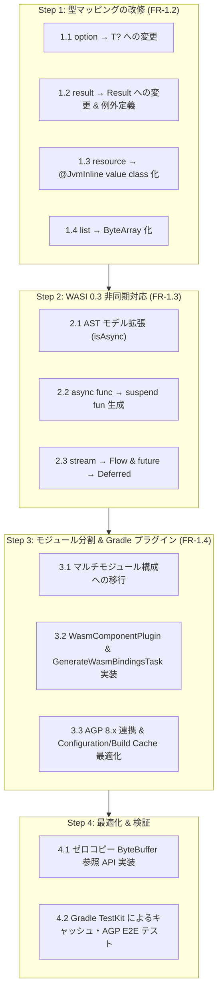

# フェーズ1 実装作業洗い出しレポート (`PHASE1_IMPLEMENTATION_TASKS.md`)

> **記録用のメモです（2026-10-31 時点）。** Step 3（Gradle プラグイン、AGP 連携、キャッシュ対応、TestKit）は実施済みです。
> 残りの項目は Issue に引き継いでいます: 型マッピングの変更は [#17](https://github.com/chikoski/wasm-component-kotlin/issues/17)、async は [#16](https://github.com/chikoski/wasm-component-kotlin/issues/16)、モジュール分割の残りは [#11](https://github.com/chikoski/wasm-component-kotlin/issues/11)。
> リンク先のコードは当時から変わっている場合があります。最新の状況は [docs/STATUS.md](../STATUS.md) を参照してください。

本ドキュメントは、[wasm-component-kotlin](https://github.com/chikoski/wasm-component-kotlin) リポジトリの現行コードベースを精査し、仕様書における **「フェーズ1：WIT パーサー & 型マッピング（wasm-component-gradle-plugin）」** を実現するために必要な作業項目を **「そのまま使える部分」「修正が必要な部分」「新規に実装が必要な部分」** に分類・整理した実装計画書です。

---

## 1. エグゼクティブサマリー & 要件スコープ

### 1.1 フェーズ1 要求仕様一覧 (FR-1.1 〜 FR-1.4)
* **FR-1.1 (WIT パース)**: WIT 仕様に準拠した型構文のパース（`record`, `variant`, `enum`, `flags`, `list`, `option`, `result`, `resource`）。
* **FR-1.2 (Kotlin イディオマティックな型変換)**:
  * `record` → Kotlin `data class`
  * `variant` → Kotlin `sealed interface`（各ケースを `data class` / `data object`）
  * `enum` → Kotlin `enum class`
  * `list<u8>` → `ByteArray`（デフォルト）および ゼロコピー `ByteBuffer` 参照 API（最適化モード）
  * `option<T>` → `T?`（Kotlin Nullable）
  * `result<T, E>` → `kotlin.Result<T>`
  * `resource` → `@JvmInline value class` によるゼロアロケーションハンドル（`AutoCloseable` 実装）
* **FR-1.3 (WASI 0.3 非同期シグネチャのマッピング)**:
  * `async func foo(...) -> T` → `suspend fun foo(...): T`
  * `stream<T>` → `kotlinx.coroutines.flow.Flow<T>`
  * `future<T>` → `suspend fun` または `Deferred<T>`
* **FR-1.4 (Gradle エコシステム準拠)**:
  * `wasm-component-gradle-plugin` の実装
  * AGP (Android Gradle Plugin) 8.x 完全対応
  * Gradle Configuration Cache および Build Cache 完全準拠（`@CacheableTask`）

### 1.2 現行リポジトリの状況と主な実装ギャップ
現行の `wasm-component-kotlin` は、CLI（`wasm2kt` コマンドラインツール）および KotlinPoet コード生成器コア（`WitToKotlinPoetConverter`）、Wasmtime ランタイムブリッジ（FFM / JNI / InMemory）がすでに単一の Gradle プロジェクト内に実装されており、高い完成度を持っています。

しかし、フェーズ1の要件と比較すると以下の**3大ギャップ**が存在します：
1. **型マッピング方針の差異 (FR-1.2)**:
   * 現行は代数的安全性を優先し、独自型 `WitOption<T>` / `WitResult<T, E>` / 通常のヒープ割り当て `class <Resource> : AutoCloseable` を生成しています。これを Kotlin 標準の `T?` / `kotlin.Result<T>` / `@JvmInline value class` に切り替える必要があります。
   * `list<u8>` が汎用の `List<UByte>` になっているため、`ByteArray` / `ByteBuffer` への最適化が必要です。
2. **WASI 0.3 非同期仕様への未対応 (FR-1.3)**:
   * AST およびコード生成器が同期関数（`fun`）のみを前提としており、`async func`（`suspend fun`）や `stream<T>`（`Flow<T>`）へのマッピングが未実装です。
3. **Gradle プラグインの欠如 (FR-1.4)**:
   * 現在は CLI のみであり、`wasm-component-gradle-plugin` は存在していません。AGP 8.x や Configuration Cache / Build Cache に対応したタスク設計が必要です。

---

## 2. そのまま使える部分 (Reusable as-is)

現行コードベースのうち、フェーズ1の要件を満たしており、そのまま流用可能なコンポーネントです。

| 対象領域 | 該当ファイル / クラス | 説明 |
| :--- | :--- | :--- |
| **WIT AST パース基盤** | [`WitAst.kt`](../../ast/src/main/kotlin/wasm2kt/ast/WitAst.kt)<br>• `WitResolve`<br>• `WitWorld`<br>• `WitInterface`<br>• `WitTypeDefKind.*` | `wasm-tools component wit --json` が出力する JSON AST を `kotlinx.serialization` でデコードする構造定義。`record`, `variant`, `enum`, `flags`, `tuple` などのパースとバリデーションは完全に確立されています。 |
| **代数的データ型マッピング** | [`WitToKotlinPoetConverter.kt`](../../generator/src/main/kotlin/wasm2kt/generator/WitToKotlinPoetConverter.kt)<br>• `buildRecordTypeSpec`<br>• `buildVariantTypeSpec`<br>• `buildEnumTypeSpec`<br>• `buildFlagsTypeSpec`<br>• `buildTupleTypeSpec` | • `record` → Kotlin `data class`<br>• `variant` → `sealed interface` + `data class` / `data object`<br>• `enum` → `enum class`<br>• `flags` → `@JvmInline value class` + ビット演算子 (`or`, `and`, `inv`)<br>• `tuple` → `TupleN`<br>これらは FR-1.2 の要件に完全合致しています。 |
| **命名規則 & 識別子変換** | [`NamingConventions.kt`](../../generator/src/main/kotlin/wasm2kt/generator/NamingConventions.kt) | WIT のケバブケース（`kebab-case`）から Kotlin のキャメルケース（`camelCase`）、パスカルケース（`PascalCase`）、スネークケース、Kotlin 予約語衝突時のバッククォートエスケープ処理。 |
| **World & DSL 骨格生成** | [`WitToKotlinPoetConverter.kt`](../../generator/src/main/kotlin/wasm2kt/generator/WitToKotlinPoetConverter.kt)<br>• `generateWorldFile`<br>• `withSession` / `openSession` | WIT の `world` を Kotlin シングルトン `object` として表現し、`withSession` ブロックや Kotlin Context Parameters (`context(session: Session)`) を展開する基本構造。 |
| **KotlinPoet 整形 & 出力パイプライン** | [`WitToKotlinPoetConverter.kt`](../../generator/src/main/kotlin/wasm2kt/generator/WitToKotlinPoetConverter.kt)<br>• `formatIdiomaticKotlin`<br>• `GeneratedKotlinFile.writeTo` | 生成された AST から冗長な `public` 修飾子を除去し、イディオマティックな Kotlin コードとしてファイル書き出しを行うパイプライン。 |
| **静的 JSON コーデック基盤** | [`WitJsonSerializable`](../../runtime-wasmtime/src/main/kotlin/wasm2kt/runtime/FfmWasmtimeBridge.kt)<br>[`WitHostImportDispatcher`](../../runtime-wasmtime/src/main/kotlin/wasm2kt/runtime/FfmWasmtimeBridge.kt) | リフレクションを一切使用せず、KotlinPoet で各型専用の `toWitJson()` / `fromWitJson()` を静的出力するアーキテクチャ（R8 / ProGuard 耐性）。 |

---

## 3. 修正が必要な部分 (Modifications Needed)

既存のコードをベースに、フェーズ1の要件（特に FR-1.2 および FR-1.3）に合わせて仕様変更・リファクタリングが必要なコンポーネントです。

### 3.1 `option<T>` のマッピング（FR-1.2）
* **現状**:
  * 独自の代数的型 [`WitOption<out T>`](../../generator/src/main/kotlin/wasm2kt/generator/WitToKotlinPoetConverter.kt)（`Some<T>`, `None`）を定義・生成。
* **変更要件**:
  * Kotlin 標準の **Nullable 型（`T?`）** に統一する。
* **必要な改修作業**:
  1. [`WitToKotlinPoetConverter.kt` (`mapTypeRef` / `mapTypeDefByIndex`)](../../generator/src/main/kotlin/wasm2kt/generator/WitToKotlinPoetConverter.kt):
     * `WitTypeDefKind.OptionType` の戻り値を `mapTypeRef(kind.type).copy(nullable = true)` に変更。
  2. [`buildDecodeExpression`](../../generator/src/main/kotlin/wasm2kt/generator/WitToKotlinPoetConverter.kt):
     * `WitOption.fromWitJson(...)` の呼び出しを、`if (%L is JsonNull) null else %L`（内側型のデコード式）に変更。
  3. [`formatArgumentCode`](../../generator/src/main/kotlin/wasm2kt/generator/WitToKotlinPoetConverter.kt):
     * 引数渡し時のシリアライズ式を `param?.let { encode(it) } ?: JsonNull` に変更。
  4. [`generateCommonSupportFile`](../../generator/src/main/kotlin/wasm2kt/generator/WitToKotlinPoetConverter.kt):
     * `WitOption` の定義出力処理を廃止。

### 3.2 `result<T, E>` のマッピング（FR-1.2）
* **現状**:
  * 独自の代数的型 [`WitResult<out T, out E>`](../../generator/src/main/kotlin/wasm2kt/generator/WitToKotlinPoetConverter.kt)（`Ok<T>`, `Err<E>`）を定義・生成。
* **変更要件**:
  * Kotlin 標準の **`kotlin.Result<T>`** に統一する。
* **必要な改修作業**:
  1. **エラー型 `E` の例外ラッピング機構の設計**:
     * Kotlin の `kotlin.Result` は失敗時の値として `java.lang.Throwable` を要求します。しかし WIT の `E` は任意の型（`string`, `enum`, `record`, `variant` 等）になり得ます。
     * 汎用例外クラス `class WitComponentException(val error: Any?) : RuntimeException("WIT result error: $error")` をランタイムサポートとして導入。
  2. [`mapTypeRef` / `mapTypeDefByIndex`](../../generator/src/main/kotlin/wasm2kt/generator/WitToKotlinPoetConverter.kt):
     * `WitTypeDefKind.ResultType` の型を `ClassName("kotlin", "Result").parameterizedBy(okType)` に変更。
  3. [`buildDecodeExpression`](../../generator/src/main/kotlin/wasm2kt/generator/WitToKotlinPoetConverter.kt):
     * JSON レスポンスが `{"ok": ...}` の場合は `Result.success(...)`、`{"err": ...}` の場合は `Result.failure(WitComponentException(...))` を生成するコードに変更。
  4. [`generateCommonSupportFile`](../../generator/src/main/kotlin/wasm2kt/generator/WitToKotlinPoetConverter.kt):
     * `WitResult` クラスの生成を廃止し、`WitComponentException` を共通ファイルへ出力。

### 3.3 `resource` のゼロアロケーション化（FR-1.2）
* **現状**:
  * 通常のヒープ割り当てクラス [`class <Resource>(session: Session?, val handle: Int) : AutoCloseable`](../../generator/src/main/kotlin/wasm2kt/generator/WitToKotlinPoetConverter.kt) を生成。内部で `session` インスタンスや `isClosed: Boolean` 状態を保持している。
* **変更要件**:
  * **`@JvmInline value class <Resource>(val handle: Int) : AutoCloseable`** によるゼロアロケーションハンドルにする。
* **必要な改修作業**:
  1. **value class の単一フィールド制約への適合**:
     * `@JvmInline value class` はプロパティを1つしか持てない（`val handle: Int` のみ）。
     * そのため、インスタンス変数としての `session` や `isClosed` を削除。
  2. **ライフサイクル & セッション紐付けの再設計**:
     * `Resource` のメンバメソッドおよび `close()` を、Kotlin の Context Parameters (`context(session: <World>.Session)`) またはセッションスコープ付きの拡張関数に移行。
     * 例:
       ```kotlin
       @JvmInline
       value class Counter(val handle: Int) : AutoCloseable {
           // context parameters を用いてセッション経由で解放
           context(session: CounterWorld.Session)
           override fun close() {
               session.runtimeSession.dropResource(handle)
           }
       }
       ```
  3. [`buildResourceTypeSpec`](../../generator/src/main/kotlin/wasm2kt/generator/WitToKotlinPoetConverter.kt):
     * クラス修飾子に `KModifier.VALUE` を指定し、`@JvmInline` アノテーションを付加。
     * コンストラクタ引数を `handle: Int` のみに簡素化。

### 3.4 `list<u8>` のマッピング（FR-1.2）
* **現状**:
  * すべての `list<T>` が汎用の `List<T>` にマッピングされており、`list<u8>` も `List<UByte>`（または `List<Byte>`）になっている。要素ごとにボクシングが発生し、配列サイズが大きい場合のオーバーヘッドが大きい。
* **変更要件**:
  * `list<u8>` はデフォルトで **`ByteArray`** にマッピングする。
* **必要な改修作業**:
  1. [`mapTypeRef` / `mapTypeDefByIndex`](../../generator/src/main/kotlin/wasm2kt/generator/WitToKotlinPoetConverter.kt):
     * `WitTypeDefKind.ListType` の要素型が `u8`（`WitTypeRef.Primitive("u8")`）であるかを判定。
     * `u8` の場合は `BYTE_ARRAY`（`kotlin.ByteArray`）を返す分岐を追加。
  2. [`buildDecodeExpression`](../../generator/src/main/kotlin/wasm2kt/generator/WitToKotlinPoetConverter.kt):
     * `list<u8>` 用に Base64 文字列デコード（またはバイト配列 JSON からの高速一括コピー）を行う `FfmJsonCodec.decodeByteArray(...)` を呼び出す式に変更。

### 3.5 AST パースモデルの WASI 0.3 拡張（FR-1.1 / FR-1.3）
* **現状**:
  * [`WitAst.kt` の `WitFunction`](../../ast/src/main/kotlin/wasm2kt/ast/WitAst.kt) には `async` を表すフラグが存在しない。
* **必要な改修作業**:
  1. `WitFunction` に `val isAsync: Boolean = false`（または `val kind` や属性マップからの抽出）を追加。
  2. `wasm-tools component wit --json` の最新バージョン（WASI 0.3 / Component Model Async）の JSON スキーマを検証し、`async func` のシリアライズ形式を正確にパースできるようデシリアライザを更新。

---

## 4. 新規に実装が必要な部分 (New Implementations Required)

現行リポジトリには存在せず、フェーズ1を満たすために完全に新規開発が必要なコンポーネントです。

### 4.1 `wasm-component-gradle-plugin` の新規作成（FR-1.4）
ビルドシステム（Gradle）から WIT コード生成をシームレスに行うための公式プラグインを新規開発します。

#### (1) モジュール分割アーキテクチャの確立
現行の単一プロジェクト構成から、マルチモジュール構成へリファクタリングします：
```text
wasm-component-kotlin/
├── wasm2kt-ast/                  # [新規抽出] WIT JSON AST モデル
├── wasm2kt-generator/            # [新規抽出] KotlinPoet コード生成器コア
├── wasm2kt-runtime/              # [新規抽出] ランタイム基盤 (FFM / JNI / In-Memory / WitSupport)
├── wasm2kt-cli/                  # [既存維持] CLI コマンドラインツール
└── wasm-component-gradle-plugin/ # [★完全新規] Gradle / AGP 統合プラグイン
```

#### (2) Gradle プラグイン本体の実装 (`WasmComponentPlugin.kt`)
* **DSL 拡張 (`WasmComponentExtension.kt`)**:
  ```kotlin
  interface WasmComponentExtension {
      val witDir: DirectoryProperty         // 入力 .wit ディレクトリ
      val wasmFiles: ConfigurableFileCollection // または .wasm コンポーネント
      val targetPackage: Property<String>   // 出力 Kotlin パッケージ名
      val targetWorld: Property<String>     // 対象 World 名（省略可）
      val optimizeByteBuffer: Property<Boolean> // FR-1.2 最適化モードフラグ
      val wasmToolsPath: Property<String>   // wasm-tools バイナリパス（省略時は PATH）
  }
  ```
* **AGP 8.x (`com.android.application`, `com.android.library`) & Kotlin JVM 連携**:
  * `plugins.withId("org.jetbrains.kotlin.jvm")` および `plugins.withId("com.android.base")` を検知。
  * AGP 8.x の新しい Variant API（`androidComponents.onVariants`）にフックし、生成コードディレクトリを Android のソースセット（`sources.kotlin`）に安全に登録。
  * タスクの依存関係を `compileKotlin` / `compileDebugKotlin` の前に自動配線。

#### (3) キャッシュ完全準拠タスクの実装 (`GenerateWasmBindingsTask.kt`)
* **`@CacheableTask` の実装要件**:
  ```kotlin
  @CacheableTask
  abstract class GenerateWasmBindingsTask : DefaultTask() {
      @get:InputDirectory
      @get:PathSensitive(PathSensitivity.RELATIVE)
      abstract val witDirectory: DirectoryProperty

      @get:Input
      abstract val targetPackage: Property<String>

      @get:Input
      @get:Optional
      abstract val targetWorld: Property<String?>

      @get:Input
      abstract val optimizeByteBuffer: Property<Boolean>

      @get:OutputDirectory
      abstract val outputDirectory: DirectoryProperty

      @TaskAction
      fun generate() { ... }
  }
  ```
* **Gradle Configuration Cache 対応**:
  * タスク実行時（Execution Phase）に `Project` インスタンスやグローバル状態へのアクセスを一切禁止。
  * すべてのパラメータを Gradle の Lazy Configuration (`Property<T>`, `DirectoryProperty`, `Provider<T>`) で管理。
* **Gradle Build Cache 対応**:
  * 入力ディレクトリ（WIT ファイル群）と設定値から入力ハッシュ（Cache Key）を決定し、WIT に変更がない場合はビルド間でキャッシュから瞬時に出力を復元（`FROM-CACHE`）。
* **Worker API による並列・独立実行**:
  * `WorkerExecutor` を活用し、デーモンプロセス内でクラスローダを分離してコード生成を高速実行。

---

### 4.2 WASI 0.3 非同期シグネチャのマッピング（FR-1.3）

#### (1) `async func` → `suspend fun`
* **コード生成側の改修**:
  * WIT の `async func foo(params) -> T` を検知した際、KotlinPoet の `FunSpec.builder` に `KModifier.SUSPEND` を追加。
  * 戻り値型はそのまま `T`（または `Result<T>`）とする。
* **ランタイム呼び出しブリッジ**:
  * Wasmtime の非同期タスク完了待機機構（またはホストイベントループ）と Kotlin Coroutines の `suspendCancellableCoroutine` を連携させる呼び出しテンプレートを生成。

#### (2) `stream<T>` → `Flow<T>`
* **型マッピング**:
  * `WitTypeDefKind.StreamType` を `kotlinx.coroutines.flow.Flow<T>`（`ClassName("kotlinx.coroutines.flow", "Flow").parameterizedBy(innerType)`）にマッピング。
* **ストリーミングデコード・ランタイムアダプタ**:
  * Wasmtime の `stream` ハンドルから要素を順次プルし、`flow { emit(item) }` で Kotlin 側にストリーム供給するヘルパーランタイム関数を実装。

#### (3) `future<T>` → `suspend fun` または `Deferred<T>`
* **型マッピング**:
  * `WitTypeDefKind.FutureType` を `kotlinx.coroutines.Deferred<T>`（`ClassName("kotlinx.coroutines", "Deferred").parameterizedBy(innerType)`）にマッピング。
  * または、関数の戻り値に直接現れる場合は `suspend fun` の戻り値 `T` としてアンラップ。

---

### 4.3 ゼロコピー `ByteBuffer` 参照 API（FR-1.2 最適化モード）
大容量データ（画像、音声、センサーバイナリ等）の受渡しにおいて、ヒープ確保とコピーを排除するモードを提供します。

* **実装設計**:
  * プラグインの `optimizeByteBuffer.set(true)` 設定時、`list<u8>` のマッピングを `ByteArray` ではなく `java.nio.ByteBuffer`（Direct ByteBuffer）に切り替える。
  * Wasmtime の線形メモリ（`memory`）の該当オフセットおよび長さを直接指す `ByteBuffer` スライスを生成し、Kotlin 側でゼロコピー参照を可能にする。
  * メモリ安全性の保護: Wasm 側のメモリ再配置（Memory Growth）によってポインタが無効化されないよう、スコープ付きアクセサ（`withByteBuffer { buffer -> ... }`）として提供。

---

### 4.4 テストスイートの新規作成
* **Gradle TestKit によるプラグイン E2E テスト**:
  * `GradleRunner` を使用した単体・統合テスト。
  * **Configuration Cache 検証**: `--configuration-cache` フラグを付与してタスクを実行し、キャッシュの保存・復元がエラーなく動作することを検証。
  * **Build Cache 検証**: タスクを2回連続実行し、2回目が `UP-TO-DATE` または `FROM-CACHE` になることを検証。
  * **AGP 8.x サンプルアプリ検証**: Android モックプロジェクトに対するプラグイン適用とコード生成、コンパイル成功の検証。
* **新型マッピング（`T?`, `Result<T>`, `@JvmInline value class`, `ByteArray`, Coroutines）の検証**:
  * 生成されたコードが Kotlin 2.2 コンパイラでエラーなくコンパイルでき、実行時セマンティクスが正しいことを検証するユニットテスト。

---

## 5. 作業タスクリスト & 実装ロードマップ

フェーズ1実装の推奨順序と作業項目一覧です。



### 詳細タスクチェックリスト

#### ■ Step 1: 型マッピングの改修 (FR-1.2)
- [ ] `WitOption<T>` を廃止し、`option<T>` を Kotlin Nullable (`T?`) にマッピングする。
- [ ] `WitResult<T, E>` を廃止し、`result<T, E>` を `kotlin.Result<T>` にマッピングする。
- [ ] 独自例外クラス `WitComponentException` をランタイムサポートに追加し、`E` の値を保持できるようにする。
- [ ] `resource` クラスを `@JvmInline value class <Resource>(val handle: Int) : AutoCloseable` に変更し、セッションコンテキスト伝達方式を適合させる。
- [ ] `list<u8>` を検知して `ByteArray` にマッピングし、デコード処理を最適化する。
- [ ] 既存のユニットテストスイートを新型マッピングに合わせて更新・通過させる。

#### ■ Step 2: WASI 0.3 非同期シグネチャのマッピング (FR-1.3)
- [ ] `WitAst.kt` の `WitFunction` に `isAsync: Boolean` を追加し、WASI 0.3 の JSON AST からパースできるようにする。
- [ ] `isAsync == true` の関数に対して `suspend fun` を生成するよう `WitToKotlinPoetConverter` を改修。
- [ ] `stream<T>` を `kotlinx.coroutines.flow.Flow<T>` にマッピングし、ランタイム側の Flow 生成コードを追加。
- [ ] `future<T>` を `Deferred<T>` または `suspend` 戻り値にマッピング。
- [ ] コルーチン統合のテストケースを追加。

#### ■ Step 3: モジュール分割 & Gradle プラグインの実装 (FR-1.4)
- [ ] プロジェクトを `wasm2kt-ast`, `wasm2kt-generator`, `wasm2kt-runtime`, `wasm2kt-cli`, `wasm-component-gradle-plugin` にマルチモジュール化。
- [ ] `wasm-component-gradle-plugin` に `WasmComponentExtension` を実装。
- [ ] `@CacheableTask` を付与した `GenerateWasmBindingsTask` を実装（入力ディレクトリ、出力ディレクトリ、パッケージ名のプロパティ化）。
- [ ] Gradle Configuration Cache 違反（`Project` の不用意な参照等）を排除。
- [ ] AGP 8.x の Variant API を通じて、Android アプリ/ライブラリの Kotlin ソースセットへ生成コードディレクトリを自動登録。
- [ ] Kotlin JVM プラグイン向けにも同様に `sourceSets.main.kotlin.srcDir` を自動登録。

#### ■ Step 4: 最適化 & 統合検証 (FR-1.2 最適化 & FR-1.4 テスト)
- [ ] `optimizeByteBuffer` 設定時に `list<u8>` を Direct `ByteBuffer` 参照にするゼロコピー API を実装。
- [ ] `GradleRunner` (TestKit) を用いて、Configuration Cache のヒットおよび Build Cache の再利用（`FROM-CACHE`）を検証する自動テストを作成。
- [ ] AGP 8.x を使用したサンプルプロジェクトでのビルド・実行 E2E テストを実施。
