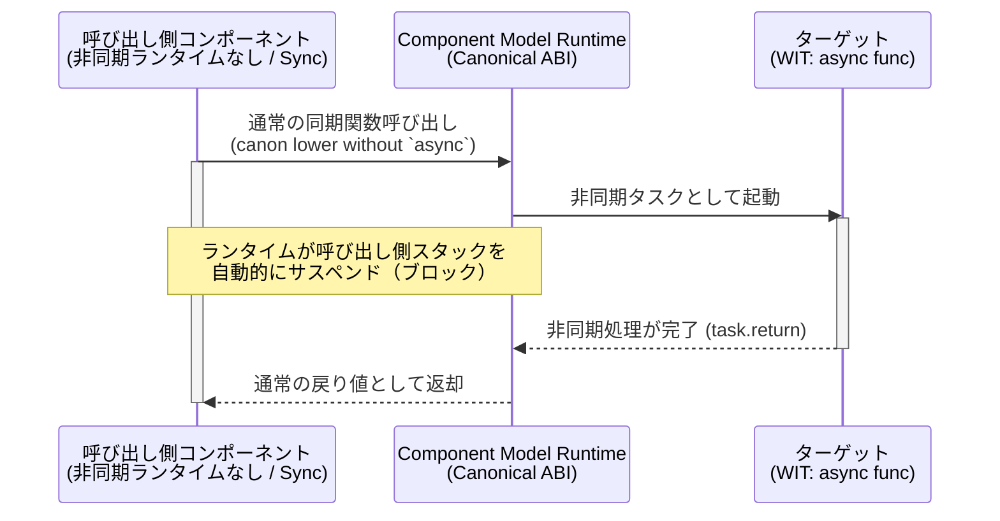
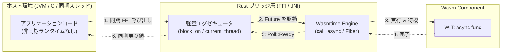

# WIT における非同期関数の定義と、非同期ランタイムを持たない環境からの呼び出し定石

> **調査メモです。** async（WASI P3）対応は [#16](https://github.com/chikoski/wasm-component-kotlin/issues/16) で扱います。

## 結論（エグゼクティブサマリー）

1. **WIT に非同期関数は定義できるか？**
   * **可能**です。ただし、ターゲットとする **WASI / Component Model のバージョン**によって表現方法が異なります。
   * **WASI 0.2（Preview 2）**: WIT の関数自体はすべて同期（`func`）であり、非同期処理は **`resource pollable`（ポーリング可能なリソース）を返すパターン**で表現します。
   * **WASI 0.3（Preview 3 / Component Model Async）**: WIT の言語仕様にネイティブな非同期プリミティブとして **`async func`、`future<T>`、`stream<T>`** が導入され、直接宣言できます。

2. **非同期ランタイムを持たない環境から呼び出す場合の定石は？**
   * **Guest（Wasm コンポーネント内）や他コンポーネントから呼ぶ場合**:
     * **WASI 0.3**: Canonical ABI の **Synchronous Lowering（`canon lower` に `async` を指定しない）** を利用します。Component Model の仕様により、`async func` であっても呼び出し側は通常のブロッキング関数として透過的に呼び出すことができます。
     * **WASI 0.2**: 返却された `pollable` リソースに対して **`.block()` メソッド（または `wasi:io/poll.poll`）を直接呼び出し**、完了するまで現在の実行フローを同期ブロックさせます。
   * **Host（C / JNI / プレーンな JVM スレッド等）から Wasmtime 経由で呼ぶ場合**:
     * ホストの公開 API は同期関数（ブロッキング）に保ちつつ、FFI 境界の内部（Rust ブリッジ層など）に **極小のシングルスレッド `block_on` エグゼキュータ（`futures::executor::block_on` や `tokio::runtime::Builder::new_current_thread()`）を隠蔽して `call_async` を駆動する**のが定石です。

---

## 1. WIT における非同期関数の定義方法

WebAssembly Component Model において、非同期処理の定義は **WASI 0.2** と **WASI 0.3** で大きくアプローチが進化しています。

### 1.1 WASI 0.2（Preview 2）：`pollable` リソースによる表現
WASI 0.2 時点の WIT には `async` キーワードが存在しません。代わりに、`wasi:io/poll` インターフェースの `pollable` リソースを用いて「後から完了を待ち合わせできるハンドル」を返す設計をとります。

```wit
package example:http@0.2.0;

use wasi:io/poll@0.2.0.{pollable};

interface client {
    /// 非同期オペレーションの結果を表すリソース
    resource future-response {
        /// 完了待機用の pollable を取得する
        subscribe: func() -> pollable;
        /// 結果を取得する（未完了なら none、完了済みなら some(result)）
        get: func() -> option<result<string, string>>;
    }

    /// 関数自体は即座に future-response リソースを返す
    send-request: func(url: string) -> future-response;
}
```

### 1.2 WASI 0.3（Preview 3）：ネイティブ `async func` / `future<T>` / `stream<T>`
WASI 0.2 の `pollable` 方式には、コンポーネントを多段に組み合わせた際（Component A → Component B → Host）に中間コンポーネントが `pollable` を合成・中継しづらいという「サンドイッチ問題（Sandwich Problem）」がありました。

これを解決するため、**WASI 0.3（Component Model Async）** では非同期の仕組みが Canonical ABI 自体に組み込まれ、WIT で直接 `async` を記述できるようになりました。

```wit
package example:http@0.3.0;

interface client {
    /// 1. 関数自体を async として宣言
    fetch-text: async func(url: string) -> result<string, string>;

    /// 2. 第一級オブジェクトとしての future<T> / stream<T> の利用
    fetch-stream: async func(url: string) -> tuple<stream<u8>, future<result<_, string>>>;
}
```

---

## 2. 非同期ランタイムを持たない環境から呼び出す場合の定石

「非同期ランタイムを持たない環境」には大きく分けて **(A) Wasm ゲスト側（または別コンポーネント側）** と **(B) Wasm を動かすホストアプリケーション側（C/C++, JNI, 同期スレッドモデルの JVM 等）** の2つの視点があります。それぞれの定石を解説します。

---

### ケース A：非同期ランタイムを持たない「Wasm ゲスト / 別コンポーネント」から呼ぶ場合

#### 定石 A-1：【WASI 0.3】Canonical ABI の「同期 Lowering」に任せる（推奨）
Component Model Async の最大の設計特徴は、**「呼び出し側（Caller）と呼び出される側（Callee）で Sync / Async の非対称な組み合わせが ABI レベルで許容されている」** 点です。



* **仕組み**:
  WIT 上で `async func` として定義された関数であっても、それをインポートする側のコンポーネントが `canon lower` 時に `async` オプションを指定しなければ、**通常のブロッキング関数シグネチャ（Synchronous ABI）** としてバインディングが生成されます。
* **メリット**:
  呼び出し側の言語（C や同期 Rust、TinyGo など）に非同期ランタイムやイベントループは一切不要です。単なる関数呼び出しを行えば、裏側のタスク待機と再開はすべて WebAssembly ランタイム（Wasmtime 等）が吸収します。

#### 定石 A-2：【WASI 0.2】`pollable.block()` で同期的にブロックする
WASI 0.2 のインターフェースを非同期ランタイムなしで呼び出す場合は、返ってきた `pollable` リソースの `.block()` メソッド（または単一要素での `poll()`）を呼んで待機するのが定石です。

```rust
// 非同期ランタイムを持たないゲストコードでの定石（擬似 Rust コード）
fn fetch_sync(url: &str) -> Result<String, String> {
    let future_resp = client::send_request(url);
    let pollable = future_resp.subscribe();
    
    // イベントループを使わず、完了するまで同期的にブロックする
    pollable.block();
    
    // ブロックから復帰した時点で結果が確定している
    future_resp.get().expect("Result must be ready after block()")
}
```

複数の非同期処理を同時に投げたい場合でも、フルスペックの非同期ランタイムは不要であり、`wasi:io/poll.poll(list<borrow<pollable>>)` にリストを渡して OS の `select()` / `poll()` のように一括待機するのが定石です。

---

### ケース B：非同期ランタイムを持たない「ホスト環境（C, JNI, JVM 等）」から呼ぶ場合

ホストアプリケーション側が「イベントループやコルーチンを持たない純粋なブロッキングスレッド環境」であり、そこから非同期な Wasm コンポーネント（または非同期 I/O を伴う WASI コンポーネント）を呼び出す場合の定石です。

#### 定石 B-1：FFI / ブリッジ層の内部に「極小の `block_on`」を局所化する
Wasmtime などのホストランタイムで `async` コンポーネント（`TypedFunc::call_async` や `run_concurrent`）を実行する場合、Wasmtime の Rust API 自体は Rust の `Future` を要求します。

しかし、ホストアプリケーション全体（例：Java/Kotlin 側や C/C++ アプリ全体）に非同期ランタイムを導入する必要はありません。**Wasmtime をラップするブリッジ関数の内部でだけ、軽量な `block_on` を使って `Future` を同期実行して完了させる**のが定石です。



##### 実装パターン（Rust ブリッジ層の例）
1. **ホスト側で OS I/O（タイマーやソケット等）を伴わない純粋な計算・制御の非同期の場合**:
   マルチスレッドの重いランタイム（Tokio のフル機能など）は不要で、`futures::executor::block_on` や自作の数行のダミー `Waker` ループだけで駆動できます。
2. **`wasi-http` や非同期ホスト関数など Tokio ベースの I/O を伴う場合**:
   Tokio の `current_thread` ランタイムをスレッドローカルまたはセッション単位で保持し、`runtime.block_on(...)` で呼び出しを同期化します。

```rust
// ホスト(JNI / C ABI)に対しては同期関数として公開する
#[no_mangle]
pub extern "C" fn invoke_component_sync(/* ... */) -> *mut c_char {
    // 呼び出しスレッド上で完結する軽量ランタイム（または futures::executor::block_on）を使用
    let rt = tokio::runtime::Builder::new_current_thread()
        .enable_all()
        .build()
        .unwrap();

    let result = rt.block_on(async {
        // Wasmtime の非同期呼び出しをここで完結させる
        func.call_async(&mut store, &params, &mut results).await
    });
    // ...
}
```

#### 定石 B-2：ホスト関数（Imports）とゲストの非同期ギャップを Wasmtime の Fiber で吸収する
逆に「WIT 上は同期関数だが、ホスト側では非同期で処理したい（あるいはその逆）」というケースでは、Wasmtime が内蔵している **スタックスイッチング（Fiber）機能** を活用するのが定石です。

| WIT の定義 | ゲストの実装 | ホストの実装 | Wasmtime での定石アプローチ |
| :--- | :--- | :--- | :--- |
| `func` (Sync) | 同期呼び出し | 非同期 (`Future`) | `Linker::func_wrap_async` を使用。ゲストは同期ブロックしているように見えるが、Wasmtime が Fiber でスタックを退避しホストで `Future` を解決する。 |
| `async func` | 非同期呼び出し | 同期関数 (Blocking) | `Linker` に通常の同期クロージャ（または即座に `Poll::Ready` を返すラッパー）を登録。Canonical ABI が非同期呼び出し規約との変換を吸収する。 |
| `async func` | 非同期呼び出し | 非同期 (`Future`) | `Linker::func_wrap_concurrent` と `StoreContextMut::run_concurrent` を組み合わせ、ブリッジ境界で `block_on` する。 |

---

## 3. 本プロジェクト（`wasm2kt` / Kotlin ホストバインディング）への示唆

本リポジトリ（[`SPEC.md`](../../SPEC.md) および [`rust-bridge/src/lib.rs`](../../rust-bridge/src/lib.rs)）のアーキテクチャにおいて、将来的に WIT の非同期関数や WASI 0.3 コンポーネントをサポートする場合、以下の設計方針が定石となります。

1. **`kotlinx.coroutines` を必須にしないデフォルト設計**:
   * Kotlin 側の生成コード（[`SPEC.md`](../../SPEC.md) の `context(session: <World>.Session) fun ...`）は、非同期ランタイム（`kotlinx.coroutines`）を持たない環境でもそのまま使えるよう、デフォルトでは通常のブロッキング関数として生成できます。
   * [`rust-bridge/src/lib.rs`](../../rust-bridge/src/lib.rs) 側で `wasmtime` の非同期実行を `block_on` でラップすれば、FFI / JNI のインターフェース（`wasm2kt_invoke`）を一切非同期化せずに `async func` を呼び出すことが可能です。
2. **JVM Virtual Threads（Project Loom）との親和性**:
   * 本プロジェクトは **JVM 21+** をターゲットとしているため（[`SPEC.md`](../../SPEC.md)）、Kotlin コルーチン等の非同期ランタイムを導入しなくても、呼び出しを `Executors.newVirtualThreadPerTaskExecutor()` 上で実行したり、上記のブリッジ内 `block_on` と組み合わせたりすることで、シンプルな同期 API のまま高い並行性を維持できます（※FFI 呼び出し中はキャリアスレッドがピン留めされる点のみ留意）。
3. **オプションとしての `suspend fun` 生成**:
   * 将来的にコルーチン環境向けの最適化を行う場合のみ、ジェネレータのフラグ（例：`--async-mode=suspend` vs `--async-mode=blocking`）によって、WIT の `async func` を Kotlin の `suspend fun` にマッピングするか、通常の `fun` にマッピングするかを選択可能にするのが理想的です。
